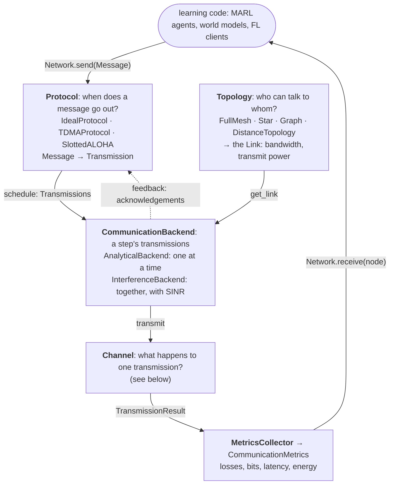
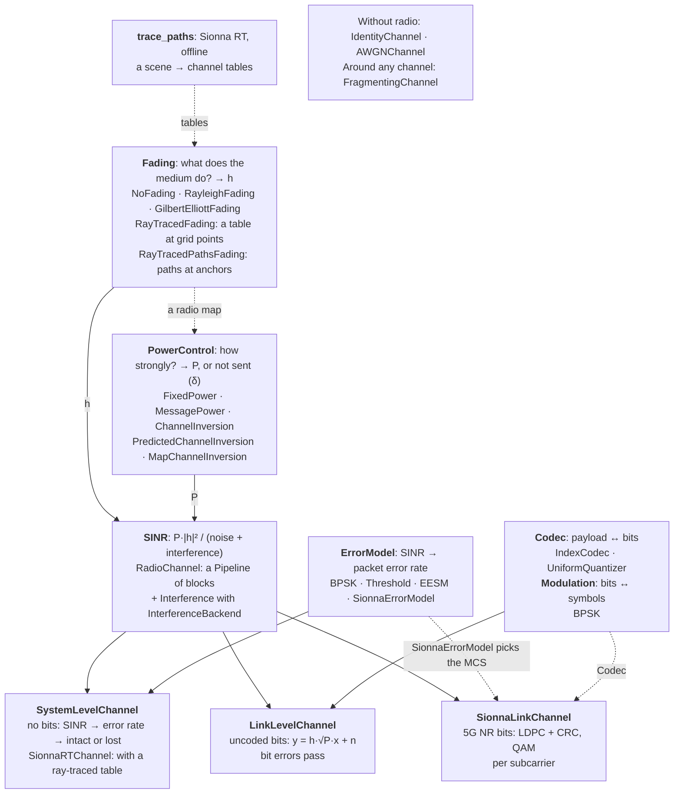

# Architecture


<!-- WARNING: THIS FILE WAS AUTOGENERATED! DO NOT EDIT! -->

## The idea

(The rules behind these choices are in [Design
principles](principles.ipynb).)

comm-core models the communication between agents that learn,
independently of how they learn: MARL agents, multi-agent world models,
federated learning clients, or anything else where several parties
exchange information. It knows nothing about observations, policies or
gradients. A payload is opaque: it is carried, delayed, corrupted or
lost, but never interpreted.

The work is split between the learning code and comm-core:

<table>
<colgroup>
<col style="width: 50%" />
<col style="width: 50%" />
</colgroup>
<thead>
<tr>
<th>the learning code decides</th>
<th>comm-core decides</th>
</tr>
</thead>
<tbody>
<tr>
<td><strong>when</strong> to communicate</td>
<td><strong>can</strong> the message go (is there a link)?</td>
</tr>
<tr>
<td><strong>what</strong> to send (the payload)</td>
<td><strong>when</strong> does it go out (scheduling, medium
access)?</td>
</tr>
<tr>
<td><strong>to whom</strong></td>
<td><strong>what</strong> arrives (losses, bit errors,
interference)?</td>
</tr>
<tr>
<td></td>
<td><strong>what</strong> did it cost (bits, latency, energy)?</td>
</tr>
</tbody>
</table>

Because of this split, the same learning code runs over a perfect
channel, a lossy one, a ray-traced radio environment or (later) an
external network simulator, by changing how the network is built, not
the learning code.

## The pieces

``` text
 learning code ── Network.send(Message) ──►  Network  ── Network.receive(node) ──► learning code
                                               │
          Topology          who can talk to whom (a Link per sender → receiver)
          Protocol          when each message goes out (Message → Transmission)
          Backend           how a step's transmissions are simulated
            └── Channel     what happens to one transmission (→ TransmissionResult)
          MetricsCollector  what it cost
```

Each abstraction answers one question:

<table>
<colgroup>
<col style="width: 33%" />
<col style="width: 33%" />
<col style="width: 33%" />
</colgroup>
<thead>
<tr>
<th>abstraction</th>
<th>question</th>
<th>implementations</th>
</tr>
</thead>
<tbody>
<tr>
<td><a
href="https://Ahmed-Khaled-Saleh.github.io/comm-core/topology.html#topology"><code>Topology</code></a></td>
<td>Who can communicate with whom?</td>
<td><a
href="https://Ahmed-Khaled-Saleh.github.io/comm-core/topology.html#fullmeshtopology"><code>FullMeshTopology</code></a>,
<a
href="https://Ahmed-Khaled-Saleh.github.io/comm-core/topology.html#startopology"><code>StarTopology</code></a>,
<a
href="https://Ahmed-Khaled-Saleh.github.io/comm-core/topology.html#graphtopology"><code>GraphTopology</code></a>,
<a
href="https://Ahmed-Khaled-Saleh.github.io/comm-core/topology.html#distancetopology"><code>DistanceTopology</code></a></td>
</tr>
<tr>
<td><a
href="https://Ahmed-Khaled-Saleh.github.io/comm-core/protocol.html#protocol"><code>Protocol</code></a></td>
<td>When is a message transmitted?</td>
<td><a
href="https://Ahmed-Khaled-Saleh.github.io/comm-core/protocol.html#idealprotocol"><code>IdealProtocol</code></a>,
<a
href="https://Ahmed-Khaled-Saleh.github.io/comm-core/protocol.html#tdmaprotocol"><code>TDMAProtocol</code></a>,
<a
href="https://Ahmed-Khaled-Saleh.github.io/comm-core/protocol.html#slottedaloha"><code>SlottedALOHA</code></a>
(<a
href="https://Ahmed-Khaled-Saleh.github.io/comm-core/protocol.html#slottedprotocol"><code>SlottedProtocol</code></a>
to write others)</td>
</tr>
<tr>
<td><a
href="https://Ahmed-Khaled-Saleh.github.io/comm-core/backend.html#communicationbackend"><code>CommunicationBackend</code></a></td>
<td>How are the transmissions of a step simulated, together?</td>
<td><a
href="https://Ahmed-Khaled-Saleh.github.io/comm-core/backend.html#analyticalbackend"><code>AnalyticalBackend</code></a>
(one at a time), <a
href="https://Ahmed-Khaled-Saleh.github.io/comm-core/radio.html#interferencebackend"><code>InterferenceBackend</code></a>
(they interfere), <a
href="https://Ahmed-Khaled-Saleh.github.io/comm-core/backend.html#pipelinebackend"><code>PipelineBackend</code></a>
(through blocks)</td>
</tr>
<tr>
<td><a
href="https://Ahmed-Khaled-Saleh.github.io/comm-core/channel.html#channel"><code>Channel</code></a></td>
<td>What happens to one transmission?</td>
<td><a
href="https://Ahmed-Khaled-Saleh.github.io/comm-core/channel.html#identitychannel"><code>IdentityChannel</code></a>,
<a
href="https://Ahmed-Khaled-Saleh.github.io/comm-core/channel.html#awgnchannel"><code>AWGNChannel</code></a>,
<a
href="https://Ahmed-Khaled-Saleh.github.io/comm-core/system.html#systemlevelchannel"><code>SystemLevelChannel</code></a>,
<a
href="https://Ahmed-Khaled-Saleh.github.io/comm-core/link.html#linklevelchannel"><code>LinkLevelChannel</code></a>,
<a
href="https://Ahmed-Khaled-Saleh.github.io/comm-core/sionna_phy.html#sionnalinkchannel"><code>SionnaLinkChannel</code></a>,
<a
href="https://Ahmed-Khaled-Saleh.github.io/comm-core/sionna_rt.html#sionnartchannel"><code>SionnaRTChannel</code></a>,
<a
href="https://Ahmed-Khaled-Saleh.github.io/comm-core/channel.html#fragmentingchannel"><code>FragmentingChannel</code></a></td>
</tr>
<tr>
<td><a
href="https://Ahmed-Khaled-Saleh.github.io/comm-core/block.html#block"><code>Block</code></a></td>
<td>What does one step of a radio channel do to a step’s
transmissions?</td>
<td><a
href="https://Ahmed-Khaled-Saleh.github.io/comm-core/propagation.html#fading"><code>Fading</code></a>,
<a
href="https://Ahmed-Khaled-Saleh.github.io/comm-core/power_control.html#powercontrol"><code>PowerControl</code></a>,
<a
href="https://Ahmed-Khaled-Saleh.github.io/comm-core/interference.html#interference"><code>Interference</code></a>,
<a
href="https://Ahmed-Khaled-Saleh.github.io/comm-core/interference.html#sinr"><code>SINR</code></a>,
<a
href="https://Ahmed-Khaled-Saleh.github.io/comm-core/phy_abstraction.html#errormodel"><code>ErrorModel</code></a>,
<a
href="https://Ahmed-Khaled-Saleh.github.io/comm-core/phy_abstraction.html#decide"><code>Decide</code></a>,
<a
href="https://Ahmed-Khaled-Saleh.github.io/comm-core/link.html#bitlevellink"><code>BitLevelLink</code></a>,
<a
href="https://Ahmed-Khaled-Saleh.github.io/comm-core/sionna_phy.html#sionnalink"><code>SionnaLink</code></a>,
<a
href="https://Ahmed-Khaled-Saleh.github.io/comm-core/radio.html#airtime"><code>Airtime</code></a>;
<a
href="https://Ahmed-Khaled-Saleh.github.io/comm-core/block.html#pipeline"><code>Pipeline</code></a>
chains them, <a
href="https://Ahmed-Khaled-Saleh.github.io/comm-core/block.html#named"><code>Named</code></a>
wraps a Sionna block</td>
</tr>
<tr>
<td><a
href="https://Ahmed-Khaled-Saleh.github.io/comm-core/metrics.html#metricscollector"><code>MetricsCollector</code></a></td>
<td>What did communication cost?</td>
<td><a
href="https://Ahmed-Khaled-Saleh.github.io/comm-core/metrics.html#communicationmetrics"><code>CommunicationMetrics</code></a>:
transmissions, losses, bits, latency, energy</td>
</tr>
<tr>
<td><a
href="https://Ahmed-Khaled-Saleh.github.io/comm-core/network.html#network"><code>Network</code></a></td>
<td>(ties them together)</td>
<td></td>
</tr>
</tbody>
</table>

A
[`Node`](https://Ahmed-Khaled-Saleh.github.io/comm-core/core.html#node)
is passive: it does not send or receive by itself. The learning code
acts on its behalf through the
[`Network`](https://Ahmed-Khaled-Saleh.github.io/comm-core/network.html#network).

## The whole library

Every component and how they connect, in two parts. Solid arrows are
what happens at each step. Dotted arrows are set up beforehand: a
component given to another, or a table computed offline.

**A message through the network.** Each step, the protocol releases
transmissions, the topology gives their links, the backend simulates
them through the channel, and the results are counted and delivered.

<div id="network-diagram" style="overflow-x: auto"></div>



**Inside a channel.** A radio channel is a pipeline of blocks (see
`block`), each called once per step on all of its transmissions: a
[`Fading`](https://Ahmed-Khaled-Saleh.github.io/comm-core/propagation.html#fading)
(propagation) gives `h`, a
[`PowerControl`](https://Ahmed-Khaled-Saleh.github.io/comm-core/power_control.html#powercontrol)
the power,
[`SINR`](https://Ahmed-Khaled-Saleh.github.io/comm-core/interference.html#sinr)
the SINR (after
[`Interference`](https://Ahmed-Khaled-Saleh.github.io/comm-core/interference.html#interference)
with
[`InterferenceBackend`](https://Ahmed-Khaled-Saleh.github.io/comm-core/radio.html#interferencebackend)).
Then its fidelity level decides what arrives:
[`SystemLevelChannel`](https://Ahmed-Khaled-Saleh.github.io/comm-core/system.html#systemlevelchannel)
with an
[`ErrorModel`](https://Ahmed-Khaled-Saleh.github.io/comm-core/phy_abstraction.html#errormodel)
(no bits, fast), or
[`LinkLevelChannel`](https://Ahmed-Khaled-Saleh.github.io/comm-core/link.html#linklevelchannel)
/
[`SionnaLinkChannel`](https://Ahmed-Khaled-Saleh.github.io/comm-core/sionna_phy.html#sionnalinkchannel)
through a
[`Codec`](https://Ahmed-Khaled-Saleh.github.io/comm-core/link.html#codec)
(every bit).
[`Airtime`](https://Ahmed-Khaled-Saleh.github.io/comm-core/radio.html#airtime)
gives the latency and the energy.

<div id="channel-diagram" style="overflow-x: auto"></div>



<script type="module">
import mermaid from 'https://cdn.jsdelivr.net/npm/mermaid@11.4.1/dist/mermaid.esm.min.mjs';
mermaid.initialize({startOnLoad: false, flowchart: {wrappingWidth: 320}});
async function draw(id, src) { document.getElementById(id).innerHTML = (await mermaid.render(id + '-svg', src)).svg; }
draw("network-diagram", `
flowchart TB
    app(["learning code: MARL agents, world models, FL clients"])
    proto["<b>Protocol</b>: when does a message go out?<br/>IdealProtocol · TDMAProtocol · SlottedALOHA<br/>Message → Transmission"]
    topo["<b>Topology</b>: who can talk to whom?<br/>FullMesh · Star · Graph · DistanceTopology<br/>→ the Link: bandwidth, transmit power"]
    backend["<b>CommunicationBackend</b>: a step's transmissions<br/>AnalyticalBackend: one at a time<br/>InterferenceBackend: together, with SINR"]
    channel["<b>Channel</b>: what happens to one transmission?<br/>(see below)"]
    metrics["<b>MetricsCollector</b> → CommunicationMetrics<br/>losses, bits, latency, energy"]
    app -- "Network.send(Message)" --> proto
    proto -- "schedule: Transmissions" --> backend
    topo -- "get_link" --> backend
    backend -- "transmit" --> channel
    channel -- "TransmissionResult" --> metrics
    metrics -- "Network.receive(node)" --> app
    backend -. "feedback: acknowledgements" .-> proto
`);
draw("channel-diagram", `
flowchart TB
    trace["<b>trace_paths</b>: Sionna RT, offline<br/>a scene → channel tables"]
    fading["<b>Fading</b>: what does the medium do? → h<br/>NoFading · RayleighFading · GilbertElliottFading<br/>RayTracedFading: a table at grid points<br/>RayTracedPathsFading: paths at anchors"]
    power["<b>PowerControl</b>: how strongly? → P, or not sent (δ)<br/>FixedPower · MessagePower · ChannelInversion<br/>PredictedChannelInversion · MapChannelInversion"]
    budget["<b>SINR</b>: P·|h|² / (noise + interference)<br/>RadioChannel: a Pipeline of blocks<br/>+ Interference with InterferenceBackend"]
    sys["<b>SystemLevelChannel</b><br/>no bits: SINR → error rate → intact or lost<br/>SionnaRTChannel: with a ray-traced table"]
    ll["<b>LinkLevelChannel</b><br/>uncoded bits: y = h·√P·x + n<br/>bit errors pass"]
    sl["<b>SionnaLinkChannel</b><br/>5G NR bits: LDPC + CRC, QAM<br/>per subcarrier"]
    errm["<b>ErrorModel</b>: SINR → packet error rate<br/>BPSK · Threshold · EESM · SionnaErrorModel"]
    bits["<b>Codec</b>: payload ↔ bits<br/>IndexCodec · UniformQuantizer<br/><b>Modulation</b>: bits ↔ symbols<br/>BPSK"]
    simple["Without radio: IdentityChannel · AWGNChannel<br/>Around any channel: FragmentingChannel"]
    trace -. "tables" .-> fading
    fading -. "a radio map" .-> power
    fading -- "h" --> budget
    power -- "P" --> budget
    budget --> sys & ll & sl
    errm --> sys
    errm -. "SionnaErrorModel picks the MCS" .-> sl
    bits --> ll
    bits -. "Codec" .-> sl
`);
</script>

Any fading and any power control work with any fidelity level: each is
given to the channel separately. Each is a block, so a pipeline of your
own can also reuse them
([`PipelineBackend`](https://Ahmed-Khaled-Saleh.github.io/comm-core/backend.html#pipelinebackend)).

## The modules, and Sionna’s

The radio modules follow the order of a channel’s blocks, and most have
a counterpart in Sionna:

<table>
<colgroup>
<col style="width: 33%" />
<col style="width: 33%" />
<col style="width: 33%" />
</colgroup>
<thead>
<tr>
<th>module</th>
<th>what it gives</th>
<th>in Sionna</th>
</tr>
</thead>
<tbody>
<tr>
<td><code>block</code></td>
<td><a
href="https://Ahmed-Khaled-Saleh.github.io/comm-core/block.html#block"><code>Block</code></a>,
<a
href="https://Ahmed-Khaled-Saleh.github.io/comm-core/block.html#pipeline"><code>Pipeline</code></a>,
<a
href="https://Ahmed-Khaled-Saleh.github.io/comm-core/block.html#named"><code>Named</code></a></td>
<td><code>sionna.phy.Block</code> (comm-core’s is not a
<code>torch.nn.Module</code>)</td>
</tr>
<tr>
<td><code>propagation</code></td>
<td><code>h</code>: <a
href="https://Ahmed-Khaled-Saleh.github.io/comm-core/propagation.html#fading"><code>Fading</code></a>,
ray-traced tables and paths</td>
<td><code>sionna.phy.channel</code>, <code>sionna.rt</code></td>
</tr>
<tr>
<td><code>power_control</code></td>
<td>the power, and outages</td>
<td><code>sionna.sys.power_control</code></td>
</tr>
<tr>
<td><code>interference</code></td>
<td>the other senders’ power, half-duplex, the SINR</td>
<td>no module: the receiver’s SINR
(<code>sionna.phy.ofdm.PostEqualizationSINR</code>), over the channel of
every pair</td>
</tr>
<tr>
<td><code>phy_abstraction</code></td>
<td>the packet error rate, and what arrives (<a
href="https://Ahmed-Khaled-Saleh.github.io/comm-core/phy_abstraction.html#decide"><code>Decide</code></a>)</td>
<td><code>sionna.sys.phy_abstraction</code>,
<code>sionna.sys.effective_sinr</code></td>
</tr>
<tr>
<td><code>link_adaptation</code></td>
<td>the rate (MCS) of each transmission</td>
<td><code>sionna.sys.link_adaptation</code> (the inner loop)</td>
</tr>
<tr>
<td><code>radio</code></td>
<td>the channel as a pipeline, the airtime, <a
href="https://Ahmed-Khaled-Saleh.github.io/comm-core/radio.html#interferencebackend"><code>InterferenceBackend</code></a></td>
<td>none: the simulation loop a Sionna tutorial writes</td>
</tr>
<tr>
<td><code>system</code>, <code>link</code></td>
<td>the channels of each level</td>
<td>the loop, with <code>PHYAbstraction</code>;
<code>sionna.phy.mapping</code>, <code>fec</code></td>
</tr>
<tr>
<td><code>sionna_sys</code>, <code>sionna_phy</code>,
<code>sionna_rt</code></td>
<td>adapters to Sionna’s blocks</td>
<td></td>
</tr>
<tr>
<td><code>protocol</code>, <code>topology</code>,
<code>metrics</code></td>
<td>when, who with whom, what it cost</td>
<td><code>sionna.sys.scheduling</code>; Sionna’s topology and metrics
are other things (cell layouts, throughput)</td>
</tr>
</tbody>
</table>

## The data

Three records follow a message through the network:

- [`Message`](https://Ahmed-Khaled-Saleh.github.io/comm-core/core.html#message):
  what a node wants to say. It holds the sender, the receiver, the
  payload, a `type`, and `size_bits` (what the transmission costs).
- [`Transmission`](https://Ahmed-Khaled-Saleh.github.io/comm-core/core.html#transmission):
  one attempt to deliver a message. A message can take several attempts,
  e.g. retransmissions after a loss.
- [`TransmissionResult`](https://Ahmed-Khaled-Saleh.github.io/comm-core/core.html#transmissionresult):
  what happened to one attempt. It records whether it succeeded, the
  payload as delivered, the bits, latency, energy, SNR, error rate and
  `metadata`.

The receiver gets the payload of the *result*, not the message’s.
Usually they are the same, but a link-level channel delivers the payload
with its bit errors.

## Life of a message

What
[`Network.step`](https://Ahmed-Khaled-Saleh.github.io/comm-core/network.html#network.step)
does, in order:

1.  `backend.step(time)`: time-varying parts move on.
2.  `protocol.schedule(time)`: the messages allowed to go out in this
    step become transmissions. The others keep waiting in the protocol’s
    queues.
3.  `topology.get_link(...)`: the link of each transmission. It carries
    the bandwidth and the transmit power.
4.  `backend.transmit_all([...])`: the step’s transmissions, all at
    once, since they happen at the same time.
5.  For each result, the metrics record it, and if it succeeded, the
    receiver’s inbox gets the delivered payload.
6.  `protocol.feedback(results)`: the acknowledgements, e.g. to
    retransmit what was lost.

`Network.broadcast(sender, payload)` sends to the sender’s neighbours in
the topology, and to no other node: one message each, tagged with the
same `metadata['broadcast']` id. The copies are one emission. The power
control gives them one power (what the weakest neighbour within the
budget needs),
[`InterferenceBackend`](https://Ahmed-Khaled-Saleh.github.io/comm-core/radio.html#interferencebackend)
counts the sender once, the metrics charge their bits and energy once
per round, and
[`SionnaErrorModel`](https://Ahmed-Khaled-Saleh.github.io/comm-core/sionna_sys.html#sionnaerrormodel)’s
link adaptation gives them one MCS (the weakest receiver’s). Each
neighbour still hears it through its own channel, so some can get it and
others not.

Unicasts from one node in the same step are taken to be in orthogonal
sub-slots (as in TDMA within a frame): each has its own power, and they
don’t interfere with each other. Their latencies are each one’s own, not
added up.

[`Network.send`](https://Ahmed-Khaled-Saleh.github.io/comm-core/network.html#network.send)
only checks that a link exists and hands the message to the protocol;
nothing is transmitted until the next step. Here, three nodes take turns
with TDMA: `b`’s message waits for `b`’s slot.

``` python
nodes = ['a', 'b', 'c']
net = Network([Node(n) for n in nodes], FullMeshTopology(nodes), TDMAProtocol(nodes), AnalyticalBackend(IdentityChannel()))
net.send(Message('a', 'b', payload='hello from a', size_bits=96))
net.send(Message('b', 'c', payload='hello from b', size_bits=96))
for step in range(2):
    results = net.step()
    print(f'step {step}:', [(r.transmission.sender, r.transmission.receiver, r.success) for r in results])
print('b got', [m.payload for m in net.receive('b')], '| c got', [m.payload for m in net.receive('c')])
print(net.metrics.summary())
```

    step 0: [('a', 'b', True)]
    step 1: [('b', 'c', True)]
    b got ['hello from a'] | c got ['hello from b']
    CommunicationMetrics(transmissions=2, successful=2, failed=0, bits_sent=192, bits_received=192, total_latency=0.0, total_energy=0.0)

## Time

A
[`Network`](https://Ahmed-Khaled-Saleh.github.io/comm-core/network.html#network)
step advances the clock by `dt` (1 by default), and is one time slot.
All transmissions of a step happen at the same time. This is how
protocols divide time
([`SlottedProtocol`](https://Ahmed-Khaled-Saleh.github.io/comm-core/protocol.html#slottedprotocol))
and how interference arises
([`InterferenceBackend`](https://Ahmed-Khaled-Saleh.github.io/comm-core/radio.html#interferencebackend)).

There are two kinds of delay:

- **Queueing:** a message that waits in the protocol for a later step.
  The application sees it as a message arriving later.
- **Transmission:** `TransmissionResult.latency`, which is symbols /
  bandwidth when the link has a finite `bandwidth_hz`.

Applications driven by an environment, like `stable_marl.comm` in
stable-marl, take one network step per environment step.

Models in continuous time (e.g. packets with retries, replies after a
processing delay) use two more features of the
[`Network`](https://Ahmed-Khaled-Saleh.github.io/comm-core/network.html#network):

- `send(message, at=t)` sends a message at any time `t`.
- With `delayed_delivery=True`, a message arrives at its transmission’s
  start + latency, not in the step it was sent.

The example [robot control over Wi-Fi](examples/05_robot_control.ipynb)
uses both.

## Fidelity: what happens to a transmission

The channels go from perfect to detailed. The radio channels follow the
split of [Sionna](https://nvlabs.github.io/sionna/) between system-level
and link-level simulation:

<table>
<colgroup>
<col style="width: 33%" />
<col style="width: 33%" />
<col style="width: 33%" />
</colgroup>
<thead>
<tr>
<th>channel</th>
<th>models</th>
<th>use it for</th>
</tr>
</thead>
<tbody>
<tr>
<td><a
href="https://Ahmed-Khaled-Saleh.github.io/comm-core/channel.html#identitychannel"><code>IdentityChannel</code></a></td>
<td>Nothing is lost.</td>
<td>Upper bounds, debugging.</td>
</tr>
<tr>
<td><a
href="https://Ahmed-Khaled-Saleh.github.io/comm-core/channel.html#awgnchannel"><code>AWGNChannel</code></a></td>
<td>A fixed packet loss probability.</td>
<td>Simple ablations.</td>
</tr>
<tr>
<td><a
href="https://Ahmed-Khaled-Saleh.github.io/comm-core/system.html#systemlevelchannel"><code>SystemLevelChannel</code></a></td>
<td>SINR from the link budget → packet error rate → intact or lost (a
<em>PHY abstraction</em>, an <a
href="https://Ahmed-Khaled-Saleh.github.io/comm-core/phy_abstraction.html#errormodel"><code>ErrorModel</code></a>:
uncoded BPSK, a threshold, or 5G NR with LDPC codes and link adaptation
from Sionna SYS, <a
href="https://Ahmed-Khaled-Saleh.github.io/comm-core/sionna_sys.html#sionnaerrormodel"><code>SionnaErrorModel</code></a>).</td>
<td>Training, many agents: fast.</td>
</tr>
<tr>
<td><a
href="https://Ahmed-Khaled-Saleh.github.io/comm-core/link.html#linklevelchannel"><code>LinkLevelChannel</code></a></td>
<td>Every bit: payload → bits → symbols → <code>h √P x + n</code> →
detected bits → payload with its bit errors.</td>
<td>Checking the abstraction, discrete messages that tolerate bit
errors.</td>
</tr>
<tr>
<td><a
href="https://Ahmed-Khaled-Saleh.github.io/comm-core/sionna_phy.html#sionnalinkchannel"><code>SionnaLinkChannel</code></a></td>
<td>Every bit of 5G NR with Sionna PHY: LDPC with a CRC, QAM, the
channel at each subcarrier, soft demapping and decoding; the CRC decides
delivery.</td>
<td>Checking <a
href="https://Ahmed-Khaled-Saleh.github.io/comm-core/sionna_sys.html#sionnaerrormodel"><code>SionnaErrorModel</code></a>,
messages whose bits matter.</td>
</tr>
</tbody>
</table>

The radio channels share a base,
[`RadioChannel`](https://Ahmed-Khaled-Saleh.github.io/comm-core/radio.html#radiochannel):
a pipeline of blocks (see `block`), the same at every level up to the
SINR:

``` text
 Fading        → h           NoFading, RayleighFading, GilbertElliottFading, RayTracedFading (a Sionna RT table at fixed points),
                             RayTracedPathsFading (Sionna RT paths at anchors, moved to any position)
 PowerControl  → P, or not   FixedPower, ChannelInversion (outage beyond a budget), MessagePower (chosen by the sender),
                             PredictedChannelInversion (from past gains), MapChannelInversion (from a radio map)
 Interference  → I           with InterferenceBackend: the other senders' power, and half-duplex
 SINR          → P |h|² / (noise power + I)
 the receiver  → arrived?    ErrorModel + Decide (system level), BitLevelLink, SionnaLink (link level)
 Airtime       → latency, energy
```

They differ only in the receiver block. Moving between the levels
therefore changes one class, and the levels agree: the link level, with
a CRC that drops corrupted packets, loses packets as often as the system
level predicts.

``` python
def packet_loss(channel, steps=2000):
    net = Network([Node('a'), Node('b')], FullMeshTopology(['a', 'b']), IdealProtocol(), AnalyticalBackend(channel))
    net.reset(seed=0)
    for _ in range(steps):
        net.send(Message('a', 'b', payload=np.arange(8) * 30, size_bits=64))   # 8 codebook indices: 64 bits
        net.step()
    return net.metrics.summary().packet_loss

print('SNR   predicted  system-level  link-level')
for snr_db in (4, 6, 8):
    noise = 10 ** (-snr_db / 10)
    print(f'{snr_db} dB  {packet_error_rate(snr_db, 64):9.3f}  {packet_loss(SystemLevelChannel(noise_power=noise)):12.3f}'
          f'  {packet_loss(LinkLevelChannel(noise_power=noise, drop_corrupted=True)):10.3f}')
```

    SNR   predicted  system-level  link-level
    4 dB      0.553         0.571       0.550
    6 dB      0.142         0.156       0.143
    8 dB      0.012         0.013       0.013

The link-level pieces
([`IndexCodec`](https://Ahmed-Khaled-Saleh.github.io/comm-core/link.html#indexcodec),
[`UniformQuantizer`](https://Ahmed-Khaled-Saleh.github.io/comm-core/link.html#uniformquantizer),
[`BPSK`](https://Ahmed-Khaled-Saleh.github.io/comm-core/link.html#bpsk),
[`propagate`](https://Ahmed-Khaled-Saleh.github.io/comm-core/link.html#propagate),
[`ChannelInversion.allocate`](https://Ahmed-Khaled-Saleh.github.io/comm-core/power_control.html#channelinversion.allocate),
…) are also plain vectorized functions on numpy arrays or torch tensors.
Training code that needs whole batches of links can use them directly,
without the per-message objects of a
[`Network`](https://Ahmed-Khaled-Saleh.github.io/comm-core/network.html#network)
(see `link`).

## Interference and medium access

A
[`Channel`](https://Ahmed-Khaled-Saleh.github.io/comm-core/channel.html#channel)
sees one transmission at a time. Interference depends on all of a step’s
transmissions, so it belongs in the backend, which gets them together
([`CommunicationBackend.transmit_all`](https://Ahmed-Khaled-Saleh.github.io/comm-core/backend.html#communicationbackend.transmit_all)).

[`InterferenceBackend`](https://Ahmed-Khaled-Saleh.github.io/comm-core/radio.html#interferencebackend)
gives each transmission its SINR, `P |h|² / (noise + Σ P' |h'|²)`, where
the sum runs over the other senders and their paths `h'` come from the
same fading. It runs the channel’s blocks with an
[`Interference`](https://Ahmed-Khaled-Saleh.github.io/comm-core/interference.html#interference)
block after the power control. Radios are half-duplex: a node that
transmits cannot receive in the same step.

Avoiding collisions is then the protocol’s job, as in a real medium
access (MAC) layer. With four nodes on a line, all of them with
something to say at every step:

``` python
xs = np.arange(4)
d = np.abs(np.subtract.outer(xs, xs)).astype(float)
table = RayTracedFading(np.where(d > 0, 1e-3 / np.maximum(d, 1) ** 1.5, 0), [(x, 0) for x in xs])   # |h|^2 = 1e-6 / d^3
nodes = ['a', 'b', 'c', 'd']
table.set_positions({n: (i, 0) for i, n in enumerate(nodes)})

def delivered(protocol, steps=40):
    channel = SystemLevelChannel(fading=table, noise_power=1e-10, per_model='threshold', snr_threshold_db=10)
    net = Network([Node(n) for n in nodes], FullMeshTopology(nodes), protocol, InterferenceBackend(channel))
    net.reset(seed=0)
    for _ in range(steps):
        for s in nodes:
            for r in nodes:
                if s != r:
                    net.send(Message(s, r, None, size_bits=64))
        net.step()
    return net.metrics.summary().successful / (steps * len(nodes))        # per node and step, out of 3

for name, protocol in (('IdealProtocol', IdealProtocol()), ('TDMAProtocol', TDMAProtocol(nodes, queue_size=3)),
                       ('SlottedALOHA', SlottedALOHA(p=0.25, queue_size=3, seed=0))):
    print(f'{name:14s} {delivered(protocol):.2f} of 3 neighbours heard per step')
```

    IdealProtocol  0.00 of 3 neighbours heard per step
    TDMAProtocol   0.75 of 3 neighbours heard per step
    SlottedALOHA   0.34 of 3 neighbours heard per step

[`IdealProtocol`](https://Ahmed-Khaled-Saleh.github.io/comm-core/protocol.html#idealprotocol)
sends everything at once, so nobody hears: every node is transmitting.
[`TDMAProtocol`](https://Ahmed-Khaled-Saleh.github.io/comm-core/protocol.html#tdmaprotocol)
gives each node its own slot, so there are no collisions, but every node
waits for its turn.
[`SlottedALOHA`](https://Ahmed-Khaled-Saleh.github.io/comm-core/protocol.html#slottedaloha)
transmits at random, and some transmissions collide.

## Moving nodes

Positions belong to the application (e.g. an environment), so comm-core
is told about them; it never tracks them itself:

- **Fading:** a fading that depends on positions has `set_positions`.
  The radio channels pass it on: `channel.set_positions({...})` before a
  step.
  - [`RayTracedFading`](https://Ahmed-Khaled-Saleh.github.io/comm-core/propagation.html#raytracedfading)
    has channels at fixed points, for discrete environments, where nodes
    are always on them.
  - [`RayTracedPathsFading`](https://Ahmed-Khaled-Saleh.github.io/comm-core/propagation.html#raytracedpathsfading),
    for continuous environments, keeps the paths ray-traced at anchor
    points (e.g. every 5 cm) and moves them to the nodes’ exact
    positions.
- **Topology:** for a range-limited topology, build a new
  [`DistanceTopology`](https://Ahmed-Khaled-Saleh.github.io/comm-core/topology.html#distancetopology)
  when the nodes move.

stable-marl’s `CommunicationWrapper` does both at every environment
step.

## Randomness and episodes

Every random component has its own generator: the channels, the fadings
and
[`SlottedALOHA`](https://Ahmed-Khaled-Saleh.github.io/comm-core/protocol.html#slottedaloha).
comm-core never touches the global `random` or `numpy.random` state.

`Network.reset(seed)` starts a new episode. It empties the queues, the
inboxes and the metrics, and reseeds the protocol and the backend. The
backend reseeds its channel, which reseeds its fading, each with a seed
derived from the one given. The same seed replays the same episode:

``` python
def episode(net, seed):
    net.reset(seed)
    delivered = []
    for _ in range(50):
        net.send(Message('a', 'b', payload=0, size_bits=256))
        delivered += [r.success for r in net.step()]
    return delivered

net = Network([Node('a'), Node('b')], FullMeshTopology(['a', 'b']), SlottedALOHA(p=0.5),
              AnalyticalBackend(SystemLevelChannel(fading=RayleighFading(), noise_power=0.1)))
first, again, other = episode(net, 0), episode(net, 0), episode(net, 1)
print(f'seed 0 twice: the same episode ({first == again}); seed 1: another one ({first != other})')
```

    seed 0 twice: the same episode (True); seed 1: another one (True)

## Extending

Each abstraction is a small base class. To add something, subclass the
one that answers the question:

<table>
<colgroup>
<col style="width: 33%" />
<col style="width: 33%" />
<col style="width: 33%" />
</colgroup>
<thead>
<tr>
<th>to add</th>
<th>subclass</th>
<th>implement</th>
</tr>
</thead>
<tbody>
<tr>
<td>a topology</td>
<td><a
href="https://Ahmed-Khaled-Saleh.github.io/comm-core/topology.html#topology"><code>Topology</code></a>
(or build a <a
href="https://Ahmed-Khaled-Saleh.github.io/comm-core/topology.html#graphtopology"><code>GraphTopology</code></a>
from <a
href="https://Ahmed-Khaled-Saleh.github.io/comm-core/topology.html#link"><code>Link</code></a>s)</td>
<td><code>neighbors</code>, <code>is_connected</code>,
<code>get_link</code></td>
</tr>
<tr>
<td>a medium access protocol</td>
<td><a
href="https://Ahmed-Khaled-Saleh.github.io/comm-core/protocol.html#slottedprotocol"><code>SlottedProtocol</code></a></td>
<td><code>senders(slot, waiting)</code></td>
</tr>
<tr>
<td>another kind of protocol</td>
<td><a
href="https://Ahmed-Khaled-Saleh.github.io/comm-core/protocol.html#protocol"><code>Protocol</code></a></td>
<td><code>submit</code>, <code>schedule</code> (and
<code>feedback</code>, <code>reset</code>)</td>
</tr>
<tr>
<td>a propagation model</td>
<td><a
href="https://Ahmed-Khaled-Saleh.github.io/comm-core/propagation.html#fading"><code>Fading</code></a></td>
<td><code>coefficient(transmission, link)</code></td>
</tr>
<tr>
<td>a power control</td>
<td><a
href="https://Ahmed-Khaled-Saleh.github.io/comm-core/power_control.html#powercontrol"><code>PowerControl</code></a></td>
<td><code>allocate(gain, noise_power, link, message)</code></td>
</tr>
<tr>
<td>a PHY abstraction</td>
<td><a
href="https://Ahmed-Khaled-Saleh.github.io/comm-core/phy_abstraction.html#errormodel"><code>ErrorModel</code></a></td>
<td><code>rate(sinr, size_bits, group)</code></td>
</tr>
<tr>
<td>a modulation, a codec</td>
<td><a
href="https://Ahmed-Khaled-Saleh.github.io/comm-core/link.html#modulation"><code>Modulation</code></a>,
<a
href="https://Ahmed-Khaled-Saleh.github.io/comm-core/link.html#codec"><code>Codec</code></a></td>
<td><code>modulate</code>/<code>demodulate</code>,
<code>encode</code>/<code>decode</code></td>
</tr>
<tr>
<td>a step of a radio channel (shadowing, a receiver, …)</td>
<td><a
href="https://Ahmed-Khaled-Saleh.github.io/comm-core/block.html#block"><code>Block</code></a>,
or <a
href="https://Ahmed-Khaled-Saleh.github.io/comm-core/block.html#named"><code>Named</code></a>
around a Sionna block</td>
<td><code>call</code> and <code>outputs</code>; run in a <a
href="https://Ahmed-Khaled-Saleh.github.io/comm-core/backend.html#pipelinebackend"><code>PipelineBackend</code></a></td>
</tr>
<tr>
<td>a channel model</td>
<td><a
href="https://Ahmed-Khaled-Saleh.github.io/comm-core/channel.html#channel"><code>Channel</code></a>,
or <a
href="https://Ahmed-Khaled-Saleh.github.io/comm-core/radio.html#radiochannel"><code>RadioChannel</code></a>
to reuse the blocks up to the SINR</td>
<td><code>transmit(transmission, link)</code>, or
<code>receiver()</code></td>
</tr>
<tr>
<td>an external simulator (ns-3, …)</td>
<td><a
href="https://Ahmed-Khaled-Saleh.github.io/comm-core/backend.html#communicationbackend"><code>CommunicationBackend</code></a></td>
<td><code>transmit</code>, <code>transmit_all</code></td>
</tr>
</tbody>
</table>

For example, a log-distance path loss computed from the nodes’ positions
plugs into both radio channels:

``` python
class LogDistanceFading(Fading):
    "Path loss growing with distance: |h|^2 = gain_1m / d^exponent (no small-scale fading)."

    def __init__(self, exponent=3.0, gain_1m=1e-4):
        self.exponent, self.gain_1m, self.positions = exponent, gain_1m, {}

    def set_positions(self, positions):
        self.positions.update(positions)

    def coefficient(self, transmission, link):
        d = distance(self.positions[transmission.sender], self.positions[transmission.receiver])
        return math.inf if d == 0 else math.sqrt(self.gain_1m / d ** self.exponent)

channel = SystemLevelChannel(fading=LogDistanceFading(), power_control=ChannelInversion(10, max_power=0.1),
                             noise_power=1e-13)
channel.set_positions({'a': (0, 0), 'b': (10, 0), 'c': (300, 0)})
for receiver in ('b', 'c'):
    t = Transmission(Message('a', receiver, 'hi', size_bits=64), 'a', receiver, start_time=0.0)
    r = channel.transmit(t, Link('a', receiver))
    print(f'a -> {receiver}: success={r.success}, power={r.metadata["tx_power"]:.1e} W, outage={r.metadata.get("outage", False)}')
```

    a -> b: success=True, power=1.0e-05 W, outage=False
    a -> c: success=False, power=0.0e+00 W, outage=True

## Not (yet) in comm-core

- **A `CommunicationSystem` facade:** one object that builds the network
  from a few arguments, e.g. `topology='full_mesh', channel='awgn'`. The
  building blocks above would stay available for advanced use.
- **Listen-before-talk (CSMA)**, and TDMA frames computed from positions
  for spatial reuse.
- **Richer link-level models:** channel coding, other modulations, OFDM
  over the subcarriers of a ray-traced channel, MIMO.
- **Backends for external simulators** (Sionna link-level, ns-3,
  OpenAirInterface), at the backend level so that they get a whole step
  at once.
