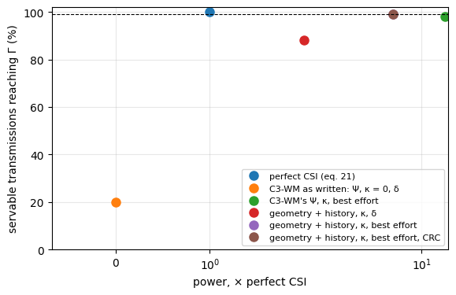
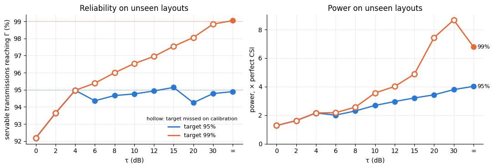

# C3-WM’s link, built from blocks


<!-- WARNING: THIS FILE WAS AUTOGENERATED! DO NOT EDIT! -->

C3-WM (Elbakary, Weeraddana and Bennis) lets agents with local world
models exchange discrete tokens over a wireless link, and sets each
transmission’s power from a predicted channel gain. Its communication
model (Sections III-B and IV-B) is a chain of steps, and each one is a
comm-core block (see `block`). Built as a
[`PipelineBackend`](https://Ahmed-Khaled-Saleh.github.io/comm-core/backend.html#pipelinebackend),
each step can be replaced on its own:

<table>
<colgroup>
<col style="width: 33%" />
<col style="width: 33%" />
<col style="width: 33%" />
</colgroup>
<thead>
<tr>
<th>C3-WM</th>
<th></th>
<th>block</th>
</tr>
</thead>
<tbody>
<tr>
<td>the channel <code>h_t</code>: ray-traced (Sionna RT) at the agents’
cells, constant during a message</td>
<td>eq. 4</td>
<td><a
href="https://Ahmed-Khaled-Saleh.github.io/comm-core/propagation.html#raytracedfading"><code>RayTracedFading</code></a></td>
</tr>
<tr>
<td>the power, <code>ρ̂ = Γσ²/ŷ</code>, from a predicted gain
<code>ŷ</code></td>
<td>eqs. 24–26</td>
<td>a <a
href="https://Ahmed-Khaled-Saleh.github.io/comm-core/power_control.html#powercontrol"><code>PowerControl</code></a></td>
</tr>
<tr>
<td>the scheduling, <code>δ = 1(ρ̂ ≤ ρ_max)</code></td>
<td>eq. 27</td>
<td><code>Schedule</code> (below)</td>
</tr>
<tr>
<td>the SNR, <code>|h|² ρ / σ²</code></td>
<td>eq. 6</td>
<td><a
href="https://Ahmed-Khaled-Saleh.github.io/comm-core/interference.html#sinr"><code>SINR</code></a></td>
</tr>
<tr>
<td>49 tokens of 8 bits, BPSK, coherent ML detection</td>
<td>eqs. 3–5</td>
<td><code>BitLevelLink(IndexCodec(256), BPSK())</code></td>
</tr>
<tr>
<td>the received tokens, or the out-of-vocabulary embedding</td>
<td>eq. 13</td>
<td><code>Tokens</code> (below)</td>
</tr>
<tr>
<td>the communication cost</td>
<td>Fig. 8b</td>
<td><a
href="https://Ahmed-Khaled-Saleh.github.io/comm-core/radio.html#airtime"><code>Airtime</code></a>,
and the network’s metrics</td>
</tr>
</tbody>
</table>

Two changes, the point of the example:

- **The gain predictor.** C3-WM’s `Ψ` is linear in `|h|²` over the
  link’s last 4 gains (eq. 24). It is replaced by the *geometry +
  history quantile* model of [power control on new
  layouts](07_power_across_layouts.ipynb): gradient-boosted trees on the
  past gains, the agents’ moves and the layout’s walls, predicting the
  gain’s 5% quantile. Swapping it is swapping one block.
- **A margin, and the scheduling rule.** Both predictors are also given
  a margin `κ`, chosen on held-out layouts, and run with C3-WM’s `δ` and
  with best effort (never withhold, send at most `ρ_max`). The rule is
  its own block.

Nothing new is ray-traced: the 40 FindGoal layouts of example 07
(`data/findgoal_layouts.npz`) are used. Two agents move at random.
C3-WM’s TDMA gives every directed link its own sub-slot, so
transmissions never overlap: there is no
[`Interference`](https://Ahmed-Khaled-Saleh.github.io/comm-core/interference.html#interference)
block. Adding one would model a shared slot. Each agent sends its 49
tokens to the other at every step; random tokens stand in for MsgNet’s.
`Γ = 10 dB`, `σ² = −94 dBm` and `ρ_max = 20 dBm`, as in example 07.

``` python
import math

import matplotlib.pyplot as plt
import numpy as np
from sklearn.ensemble import HistGradientBoostingRegressor

from comm_core import *
```

## The layouts and the agents

As in example 07: each layout holds the ray-traced gain between every
pair of free cells and the walls. Agents turn, step forward or wait at
random, like a random policy in FindGoal.

``` python
data = np.load('data/findgoal_layouts.npz')
DIRS = [(1, 0), (0, 1), (-1, 0), (0, -1)]

class Layout:
    "One ray-traced layout: the gain between any two free cells, and the walls between them."
    def __init__(self, k):
        self.seed = int(data['seeds'][k])
        self.cells = [tuple(int(v) for v in c) for c in data['cells'][k]]
        self.idx = {c: i for i, c in enumerate(self.cells)}
        self.G = 10 ** (data['gain_db'][k].astype(float) / 10)               # G[rx, tx]
        self.walls = data['walls'][k]

    def geometry(self, a, b):
        "Distance (cells) and the number of wall cells the straight line between the two cell centres crosses."
        n = max(int(abs(a[0] - b[0]) + abs(a[1] - b[1])) * 4, 1)
        xs, ys = np.linspace(a[0], b[0], n + 1), np.linspace(a[1], b[1], n + 1)
        crossed = {(int(round(x)), int(round(y))) for x, y in zip(xs, ys)} - {a, b}
        return math.hypot(a[0] - b[0], a[1] - b[1]), int(sum(self.walls[c] for c in crossed))

layouts = {int(s): Layout(k) for k, s in enumerate(data['seeds'])}
FIT, CALIBRATION, TEST = range(0, 24), range(24, 30), range(100, 110)
STEPS, HISTORY, ROLLOUTS = 60, 4, 5
AGENTS = ['agent_0', 'agent_1']

def walk(lay, seed):
    "One episode: per step, both agents' cells and headings."
    rng = np.random.default_rng(seed)
    free = set(lay.cells)
    pos = [lay.cells[k] for k in rng.choice(len(lay.cells), 2, replace=False)]
    head = [int(h) for h in rng.integers(4, size=2)]
    out = []
    for _ in range(STEPS):
        out.append((tuple(pos), tuple(head)))
        for a in rng.permutation(2):
            action = rng.integers(4)                                     # left, right, forward, nothing
            if action < 2:
                head[a] = (head[a] + (1 if action else -1)) % 4
            elif action == 2:
                ahead = (pos[a][0] + DIRS[head[a]][0], pos[a][1] + DIRS[head[a]][1])
                if ahead in free and ahead != pos[1 - a]:
                    pos[a] = ahead
    return out
```

## The channel

As in C3-WM, the channel of a link is the ray-traced coefficient between
the two agents’ cells (Section V): it is constant during a message
(quasi-static, eq. 4) and changes when an agent moves.
[`RayTracedFading`](https://Ahmed-Khaled-Saleh.github.io/comm-core/propagation.html#raytracedfading)
looks it up in the layout’s table, at the cells it is told
(`set_positions`).

## Collecting C3-WM’s channel data with the blocks

C3-WM trains its predictor on `D_channel` (eq. 22): each directed link’s
last gains and its current one. Here they come from the same block the
network will use, called outside any network on a step’s transmissions
and links, once per step of each episode. Training and deployment see
the same channel by construction.

``` python
db = lambda g: 10 * np.log10(np.maximum(g, 1e-30))
LINKS = [(Transmission(Message(a, b, None), a, b, 0.0), Link(a, b)) for a, b in (AGENTS, AGENTS[::-1])]

def channel_data(seeds):
    "Per directed link and step (after the first HISTORY): what the transmitter knows, and the true gain."
    out = []
    for seed in seeds:
        lay = layouts[seed]
        for k in range(ROLLOUTS):
            episode = walk(lay, 1000 * seed + k)
            table = RayTracedFading(np.sqrt(lay.G).astype(complex), lay.cells)
            gains = []
            for t, (cells, _) in enumerate(episode):
                table.set_positions(dict(zip(AGENTS, cells)))
                gains.append(np.abs(table(*zip(*LINKS))[:, 0]) ** 2)     # the block alone: h of both links
            gains = np.array(gains)                                      # (steps, 2): agent_0 -> agent_1, back
            for j, i in ((0, 1), (1, 0)):
                g = gains[:, j]
                for t in range(HISTORY, len(episode)):
                    (now, _), (before, heads), (earlier, _) = episode[t], episode[t - 1], episode[t - 2]
                    ahead = (before[i][0] + DIRS[heads[i]][0], before[i][1] + DIRS[heads[i]][1])
                    possible = [c for c in (before[i], ahead) if c in lay.idx and c != now[j]] or [before[i]]
                    out.append(dict(lay=lay, tx=now[j], rx=now[i], possible=possible, past=g[t - HISTORY:t][::-1].copy(),
                                    moved=[float(now[j] != before[j]), float(before[i] != earlier[i])], gain=g[t]))
    return out

fit, cal = channel_data(FIT), channel_data(CALIBRATION)
print(f'{len(fit)} transmissions to fit on (layouts 0-23), {len(cal)} to calibrate on (24-29)')
```

    13440 transmissions to fit on (layouts 0-23), 3360 to calibrate on (24-29)

Both predictors are fit on the same data. C3-WM’s `Ψ` by least squares
on `|h|²` (eq. 24,
[`fit_gain_predictor`](https://Ahmed-Khaled-Saleh.github.io/comm-core/power_control.html#fit_gain_predictor));
the quantile model on the link’s past gains in dB, the agents’ moves,
and the distance and walls to the receiver’s cell. At run time, the
receiver’s cell is known only as of its last report, so the quantile
model predicts for each cell the receiver can have reached since, and
takes the lowest (example 07).

``` python
def features(r, cell):
    distance, walls = r['lay'].geometry(r['tx'], cell)
    return [math.log10(max(distance, 0.5)), distance, walls] + list(db(r['past'])) + r['moved']

psi = fit_gain_predictor([np.r_[r['past'][::-1], r['gain']] for r in fit], history=HISTORY)
model = HistGradientBoostingRegressor(loss='quantile', quantile=0.05, max_iter=400, learning_rate=0.05, early_stopping=False,
                                      random_state=0).fit(np.array([features(r, r['rx']) for r in fit]), db(np.array([r['gain'] for r in fit])))

def quantile_estimate(rs):
    "The quantile model's gain, the lowest over each transmission's possible cells."
    pairs = [(k, c) for k, r in enumerate(rs) for c in r['possible']]
    out = np.full(len(rs), np.inf)
    np.minimum.at(out, [k for k, _ in pairs], model.predict(np.array([features(rs[k], c) for k, c in pairs])))
    return 10 ** (out / 10)

estimates = {"C3-WM's Ψ": lambda rs: np.array([max(psi(r['past']), 0.0) for r in rs]),    # eq. 25
             'geometry + history quantile': quantile_estimate}
```

**The margin.** A prediction misses the true gain by its error, so the
power aims `κ` dB above `Γ`: `ρ̂ = 10^(κ/10) Γσ²/ŷ`. Each predictor’s `κ`
is the smallest that brings 99% of the *servable* transmissions to `Γ`
on the calibration layouts, sending at most `ρ_max`. A transmission is
servable if perfect CSI could deliver it: its gain is at least
`Γσ²/ρ_max`. C3-WM itself uses no margin (`κ = 0`).

``` python
SNR_TARGET_DB, NOISE_DBM, MAX_POWER_DBM = 10.0, -94.0, 20.0
NOISE_W, MAX_POWER_W = 10 ** ((NOISE_DBM - 30) / 10), 10 ** ((MAX_POWER_DBM - 30) / 10)
GAMMA = 10 ** (SNR_TARGET_DB / 10)
G_MIN = GAMMA * NOISE_W / MAX_POWER_W                                  # the weakest servable gain
MARGINS = np.arange(0, 40.01, 0.25)

def calibrate(estimate, target=0.99):
    "(κ, share reaching Γ): the smallest κ reaching `target` on the calibration layouts, else the most reliable."
    g, ghat = np.array([r['gain'] for r in cal]), estimate(cal)
    servable, best = g >= G_MIN, None
    for margin in MARGINS:
        power = np.minimum(10 ** ((SNR_TARGET_DB + margin) / 10) * NOISE_W / np.maximum(ghat, 1e-300), MAX_POWER_W)
        share = (power * g / NOISE_W >= GAMMA * (1 - 1e-9))[servable].mean()
        if share >= target:
            return margin, share
        if best is None or share > best[1]:
            best = (margin, share)
    return best

margins = {name: calibrate(e) for name, e in estimates.items()}
for name, (margin, share) in margins.items():
    print(f'{name:28s} κ = {margin:5.2f} dB: {100 * share:.1f}% of the servable calibration transmissions reach Γ')
```

    C3-WM's Ψ                    κ = 40.00 dB: 97.5% of the servable calibration transmissions reach Γ
    geometry + history quantile  κ =  7.75 dB: 99.0% of the servable calibration transmissions reach Γ

## The power and the scheduling: two blocks

C3-WM’s eq. 26 (the power) and eq. 27 (whether to send) are separate
steps, so they are separate blocks:

- **The power** is a
  [`PowerControl`](https://Ahmed-Khaled-Saleh.github.io/comm-core/power_control.html#powercontrol).
  C3-WM’s `Ψ` is comm-core’s
  [`PredictedChannelInversion`](https://Ahmed-Khaled-Saleh.github.io/comm-core/power_control.html#predictedchannelinversion),
  which keeps each link’s past gains and uses a fallback power for the
  first `L` steps, as C3-WM does. The quantile model’s is
  `LearnedChannelInversion`, as in example 07. It needs the receiver’s
  last reported cell and heading (`update` notes where the agents are at
  every round), and the layout’s walls.
- **The scheduling** is `Schedule`. It sends only if the power asked for
  is within `10^(τ/10) ρ_max`, at no more than `ρ_max`. `τ = 0` is
  C3-WM’s `δ`; `τ = ∞` never withholds (best effort). It takes `power`
  and `active` and gives them back narrowed, so it goes right after any
  power control.

``` python
class LearnedChannelInversion(PowerControl):
    "Eq. 26 with the gain from `model` (features -> dB), the lowest over the receiver's possible cells."

    def __init__(self, model, layout, table, headings, target_snr_db, margin_db, fallback_power):
        self.model, self.layout, self.table, self.headings = model, layout, table, headings
        self.target_snr_db, self.margin_db, self.fallback_power = target_snr_db, margin_db, fallback_power
        self.reset()

    def children(self):
        return []

    def reset(self, seed=None):
        self._past, self._rounds = {}, []

    def update(self, time):
        "A new round: where the agents are now, and their headings; the earlier rounds are what they reported."
        self._rounds = (self._rounds + [(dict(self.table.node_positions), dict(self.headings()))])[-3:]

    def allocate(self, gain, noise_power, link=None, message=None):
        past = self._past.setdefault((link.sender, link.receiver), [])
        if len(past) < HISTORY or len(self._rounds) < 3:
            power = self.fallback_power                                  # not enough history yet
        else:
            (earlier, _), (before, heads), (now, _) = self._rounds
            tx, rx = now[link.sender], before[link.receiver]
            d = DIRS[heads[link.receiver]]
            possible = [c for c in (rx, (rx[0] + d[0], rx[1] + d[1])) if c in self.layout.idx and c != tx] or [rx]
            r = dict(lay=self.layout, tx=tx, past=np.array(past[-HISTORY:][::-1]),
                     moved=[float(tx != before[link.sender]), float(rx != earlier[link.receiver])])
            predicted = 10 ** (min(self.model.predict(np.array([features(r, c) for c in possible]))) / 10)
            power = 10 ** ((self.target_snr_db + self.margin_db) / 10) * noise_power / predicted
        past.append(float(gain))                                        # fed back after the transmission
        return power, True                                              # whether to send: `Schedule`'s


class Schedule(Block):
    "Eq. 27: send only if the power asked for is within the budget, `10^(τ/10) ρ_max`, at no more than `ρ_max`."
    outputs = ('power', 'active')

    def __init__(self, max_power, tau_db=0.0):
        self.max_power, self.tau_db = max_power, tau_db

    def call(self, power, active):
        return np.minimum(power, self.max_power), np.asarray(active) & (power <= self.max_power * 10 ** (self.tau_db / 10))
```

## What the receiver gets

C3-WM has no CRC: the receiver maps whatever bits it detects back to
tokens (eq. 8), errors included. When nothing arrives, its world model
gets the out-of-vocabulary embedding `e_OOV` instead (as for future
steps, eq. 13). `Tokens` is that last step: the tokens received, or
`OOV` in each place when nothing arrived. It also counts the wrong
tokens into the results’ metadata (`info`).

``` python
OOV = -1                                                               # the out-of-vocabulary token

class Tokens(Block):
    "The tokens the receiver's world model gets: the ones detected, or OOV in each place when nothing arrived."
    outputs = ('payload', 'info')

    def call(self, transmission, success, payload, info):
        tokens, extra = [], []
        for t, ok, p, i in zip(transmission, success, payload, info):
            sent = np.asarray(t.message.payload)
            got = np.asarray(p) if ok else np.full(sent.shape, OOV)
            tokens.append(got)
            extra.append({**i, 'wrong_tokens': int((got != sent).sum()) if ok else None})
        return tokens, extra
```

## The link, as a pipeline

The whole link is a list of blocks, given to a
[`PipelineBackend`](https://Ahmed-Khaled-Saleh.github.io/comm-core/backend.html#pipelinebackend).
The pipeline checks the wiring when it is built: each block’s inputs
must be the step’s, `noise_power`, or an earlier block’s outputs.

``` python
def link(lay, power_control, tau_db, crc=False):
    "C3-WM's link in one layout, with a power control, a scheduling threshold, and optionally a CRC."
    table = RayTracedFading(np.sqrt(lay.G).astype(complex), lay.cells)
    return [table, power_control(lay, table), Schedule(MAX_POWER_W, tau_db), SINR(),
            BitLevelLink(IndexCodec(256), BPSK(), drop_corrupted=crc), Tokens(), Airtime()]

backend = PipelineBackend(link(layouts[100], lambda lay, table: ChannelInversion(SNR_TARGET_DB), 0.0), noise_power=NOISE_W)
print(' → '.join(type(b).__name__ for b in backend.pipeline))
```

    RayTracedFading → ChannelInversion → Schedule → SINR → BitLevelLink → Tokens → Airtime

The power controls compared, each one block of the list:

``` python
headings = {}                                                          # the agents' headings, set at every step
CONTROLS = {                                                           # name: (power control, τ[, CRC])
    'perfect CSI (eq. 21)':
        (lambda lay, table: ChannelInversion(SNR_TARGET_DB), 0.0),
    "C3-WM as written: Ψ, κ = 0, δ":
        (lambda lay, table: PredictedChannelInversion(psi, HISTORY, SNR_TARGET_DB, fallback_power=MAX_POWER_W), 0.0),
    "C3-WM's Ψ, κ, best effort":
        (lambda lay, table: PredictedChannelInversion(psi, HISTORY, SNR_TARGET_DB, fallback_power=MAX_POWER_W,
                                                      margin_db=margins["C3-WM's Ψ"][0]), math.inf),
    'geometry + history, κ, δ':
        (lambda lay, table: LearnedChannelInversion(model, lay, table, lambda: headings, SNR_TARGET_DB,
                                                    margins['geometry + history quantile'][0], MAX_POWER_W), 0.0),
    'geometry + history, κ, best effort':
        (lambda lay, table: LearnedChannelInversion(model, lay, table, lambda: headings, SNR_TARGET_DB,
                                                    margins['geometry + history quantile'][0], MAX_POWER_W), math.inf),
    'geometry + history, κ, best effort, CRC':
        (lambda lay, table: LearnedChannelInversion(model, lay, table, lambda: headings, SNR_TARGET_DB,
                                                    margins['geometry + history quantile'][0], MAX_POWER_W), math.inf, True),
}
```

## Through a network, on unseen layouts

Each power control runs on layouts 100–109, which neither the fit nor
the calibration saw: 5 episodes per layout, 60 steps each, every agent
sending its 49 tokens to the other at every step. The first `L = 4`
steps, while the predictors have no history, are left out of the
results.

``` python
def run(power_control, tau_db, crc=False):
    "The results after the first HISTORY steps, and the communication cost per episode (KB)."
    results, cost = [], []
    for seed in TEST:
        lay = layouts[seed]
        for k in range(ROLLOUTS):
            backend = PipelineBackend(link(lay, power_control, tau_db, crc), noise_power=NOISE_W)
            net = Network([Node(a) for a in AGENTS], FullMeshTopology(AGENTS), IdealProtocol(), backend)
            net.reset(seed=1000 * seed + k)
            tokens = np.random.default_rng(1000 * seed + k)                  # stand-ins for MsgNet's tokens
            for t, (cells, heads) in enumerate(walk(lay, 1000 * seed + k)):
                backend.set_positions(dict(zip(AGENTS, cells)))
                headings.update(zip(AGENTS, heads))
                for a, b in ((0, 1), (1, 0)):
                    net.send(Message(AGENTS[a], AGENTS[b], payload=tokens.integers(256, size=49)))
                results += [r for r in net.step() if t >= HISTORY]
            cost.append(net.metrics.summary().bits_sent / 8 / 1000)
    return results, np.mean(cost)

def summary(results, cost):
    g = np.array([10 ** (r.metadata['channel_gain_db'] / 10) for r in results])
    p = np.array([r.metadata['tx_power'] for r in results])
    servable = g >= G_MIN
    return dict(
        reached=(p * g / NOISE_W >= GAMMA * (1 - 1e-9))[servable].mean(),       # servable ones reaching Γ
        power=p.mean() / np.where(servable, GAMMA * NOISE_W / g, 0).mean(),     # × perfect CSI's
        withheld=np.mean([bool(r.metadata.get('outage')) for r in results]),
        intact=np.mean([r.success and r.metadata['wrong_tokens'] == 0 for r, s in zip(results, servable) if s]),
        wrong=np.mean([r.metadata['wrong_tokens'] / 49 for r in results if r.success] or [0.0]),
        garbled=np.mean([r.success and r.metadata['wrong_tokens'] > 0 for r, s in zip(results, servable) if not s]),
        cost=cost)

out = {name: summary(*run(*control)) for name, control in CONTROLS.items()}
print(f"{'':42s}{'reach Γ':>9s}{'power':>11s}{'withheld':>10s}{'intact':>9s}{'wrong':>8s}{'garbled':>9s}{'cost':>13s}")
for name, s in out.items():
    print(f"{name:42s}{100 * s['reached']:8.1f}%{s['power']:10.3g}×{100 * s['withheld']:9.1f}%{100 * s['intact']:8.1f}%"
          f"{100 * s['wrong']:7.2f}%{100 * s['garbled']:8.1f}%{s['cost']:8.2f} KB/ep")
```

                                                reach Γ      power  withheld   intact   wrong  garbled         cost
    perfect CSI (eq. 21)                         100.0%         1×      6.3%    99.9%   0.00%     0.0%    5.50 KB/ep
    C3-WM as written: Ψ, κ = 0, δ                 19.9%   0.00138×      0.0%    39.2%  46.53%   100.0%    5.88 KB/ep
    C3-WM's Ψ, κ, best effort                     98.1%      13.7×      0.0%    99.9%   2.77%    79.8%    5.88 KB/ep
    geometry + history, κ, δ                      88.1%      2.01×     16.4%    88.6%   0.23%     2.3%    4.98 KB/ep
    geometry + history, κ, best effort            99.0%      6.79×      0.0%    99.5%   2.62%    71.3%    5.88 KB/ep
    geometry + history, κ, best effort, CRC       99.0%      6.79×      0.0%    99.5%   0.00%     0.0%    5.88 KB/ep

- **reach Γ:** the share of the servable transmissions whose SNR reaches
  `Γ`.
- **power:** the mean transmit power, relative to perfect CSI’s (exactly
  `Γσ²/g` on each servable transmission, nothing on the others).
- **withheld:** the share not sent (`δ = 0`): the receiver gets `e_OOV`.
- **intact:** the share of the servable transmissions arriving with all
  49 tokens right.
- **wrong:** the share of wrong tokens in what arrived. The receiver
  can’t tell them from right ones.
- **garbled:** the share of the *unservable* transmissions that arrive
  with wrong tokens: sent at `ρ_max` although no power could reach `Γ`.
- **cost:** the bits sent per episode (C3-WM’s Fig. 8b), in KB.

``` python
fig, ax = plt.subplots(figsize=(6.5, 4))
for name, s in out.items():
    ax.plot(s['power'], 100 * s['reached'], 'o', ms=8, label=name)
ax.axhline(99, color='k', lw=0.8, ls='--')
ax.set(xscale='symlog', xlabel='power, × perfect CSI', ylabel='servable transmissions reaching Γ (%)', ylim=(0, 102))
ax.grid(alpha=0.3)
ax.legend(fontsize=8, loc='lower right')
plt.show()
```



- **C3-WM as written fails here.** `Ψ`, fit by least squares on `|h|²`
  (eq. 24), is dominated by the strong links. Its predictions never go
  below about −63 dB, while half of the links are weaker than −66 dB and
  a link is servable down to −104 dB. A weak link therefore gets a small
  fraction of the power it needs (0.14% of perfect CSI’s, overall). Only
  20% of the servable transmissions reach `Γ`, and 47% of the tokens
  that arrive are wrong. Example 07 found the same bias.
- **A margin helps `Ψ`, but not enough.** With 40 dB, the largest tried,
  it brings 97.5% of the calibration transmissions to `Γ` and 98.1% of
  the unseen ones, never 99%, at 13.7× perfect CSI’s power. Its error
  depends on the link’s strength, and one margin can’t correct all of
  them.
- **The geometry + history quantile model meets the target, at half the
  power.** Its 7.75 dB margin, chosen on 6 layouts, brings 99.0% of the
  servable transmissions on 10 unseen layouts to `Γ`, at 6.8× perfect
  CSI’s power.
- **C3-WM’s `δ` withholds too much once there is a margin.** With the
  same model and margin, `δ = 1(ρ̂ ≤ ρ_max)` withholds 16% of the
  transmissions, servable ones among them, and only 88% reach `Γ`. It is
  cheaper (2.0× the power, 4.98 instead of 5.88 KB per episode), and
  what it withholds arrives as `e_OOV`, which the world model reads as
  “no message”.
- **Best effort without a CRC feeds wrong tokens to the world model.**
  Sent at `ρ_max`, 71% of the unservable transmissions arrive with wrong
  tokens, and the receiver can’t tell: 2.6% of the tokens it gets are
  wrong. A CRC (`BitLevelLink(drop_corrupted=True)`, one argument) turns
  them into `e_OOV` instead, with the same reliability: 99.5% of the
  servable messages still arrive intact, and no wrong token reaches the
  world model. The CRC’s own bits (e.g. 24 per message) are not counted
  here.

## Changing it further

Each step is one block of the list, so a variant changes one entry:

- **A shared slot instead of TDMA sub-slots:** `Interference(table)`
  after `Schedule`, so that the other senders’ power counts in the SINR.
- **Coded 5G NR instead of uncoded BPSK:**
  [`SionnaLink`](https://Ahmed-Khaled-Saleh.github.io/comm-core/sionna_phy.html#sionnalink)
  in place of
  [`BitLevelLink`](https://Ahmed-Khaled-Saleh.github.io/comm-core/link.html#bitlevellink)
  (see `sionna_phy`).
- **Another predictor:** another
  [`PowerControl`](https://Ahmed-Khaled-Saleh.github.io/comm-core/power_control.html#powercontrol)
  before `Schedule`,
  e.g. [`MapChannelInversion`](https://Ahmed-Khaled-Saleh.github.io/comm-core/power_control.html#mapchannelinversion)
  with a ray-traced map (a digital twin, if every layout can be
  ray-traced).
- **Another scheduling rule:** `Schedule(ρ_max, τ)` with `τ` between 0
  and ∞. Example 07 tunes it.

The numbers depend on the setting: two agents moving at random in
FindGoal’s layouts, and random tokens standing in for MsgNet’s.

## Between δ and best effort: the threshold τ

`δ` and best effort are the two ends of one rule: withhold a
transmission only when its power would exceed `10^(τ/10) ρ_max`, and
send the others at no more than `ρ_max`. `τ = 0` is C3-WM’s `δ`; `τ = ∞`
never withholds. In between, a transmission predicted to need a little
more than `ρ_max` is still sent, at `ρ_max`, and one predicted to need
far more is withheld.

The margin and the threshold work together: with a finite `τ`, a larger
margin also withholds more. So each `τ` gets its own margin, the
smallest that reaches the target on the calibration layouts. Then each
pair is judged on the unseen layouts, for a 95% and a 99% target.

This sweep is analytic. It applies each `(κ, τ)` to the same predictions
the power control makes in the network (`quantile_estimate` on the
unseen layouts’ episodes), with the BPSK bit error rate for what arrives
garbled. Two of the pairs are checked through the network below.

``` python
TAUS = (0.0, 2, 4, 6, 8, 10, 12, 15, 20, 30, math.inf)
test = channel_data(TEST)
ghat = {'cal': quantile_estimate(cal), 'test': quantile_estimate(test)}
gain = {'cal': np.array([r['gain'] for r in cal]), 'test': np.array([r['gain'] for r in test])}
ber = np.vectorize(bpsk_bit_error_rate)

def outcome(split, margin, tau):
    "(servable reaching Γ, power × perfect CSI, withheld, unservable arriving garbled) of a (κ, τ) on a split."
    g = gain[split]
    rho = 10 ** ((SNR_TARGET_DB + margin) / 10) * NOISE_W / np.maximum(ghat[split], 1e-300)
    sent = rho <= MAX_POWER_W * 10 ** (tau / 10)
    power = np.where(sent, np.minimum(rho, MAX_POWER_W), 0.0)
    servable, snr = g >= G_MIN, power * g / NOISE_W
    garbled = np.where(sent, 1 - (1 - ber(snr)) ** (49 * 8), 0.0)               # P(some bit wrong)
    return ((snr >= GAMMA * (1 - 1e-9))[servable].mean(), power.mean() / np.where(servable, GAMMA * NOISE_W / g, 0).mean(),
            1 - sent.mean(), garbled[~servable].mean())

def margin_for(target, tau):
    "The smallest κ reaching `target` on the calibration layouts with this τ; else the most reliable."
    shares = [outcome('cal', m, tau)[0] for m in MARGINS]
    met = [m for m, s in zip(MARGINS, shares) if s >= target]
    return (met[0], True) if met else (MARGINS[int(np.argmax(shares))], False)

sweep = {}
for target in (0.95, 0.99):
    for tau in TAUS:
        margin, met = margin_for(target, tau)
        sweep[target, tau] = dict(zip(('reached', 'power', 'withheld', 'garbled'), outcome('test', margin, tau)),
                                  margin=margin, met=met, cal_power=outcome('cal', margin, tau)[1])

label = lambda tau: '∞' if math.isinf(tau) else f'{tau:g}'
for target in (0.95, 0.99):
    print(f'target {100 * target:.0f}%: τ (dB), κ (dB), then on the unseen layouts: reach Γ / power / withheld / garbled '
          f'(✗: target not reached on the calibration layouts)')
    for tau in TAUS:
        s = sweep[target, tau]
        print(f"  τ = {label(tau):>3s}   κ = {s['margin']:5.2f}   {100 * s['reached']:5.1f}%  {s['power']:5.2f}×  "
              f"{100 * s['withheld']:4.1f}%  {100 * s['garbled']:4.1f}%{'' if s['met'] else '  ✗'}")
```

    target 95%: τ (dB), κ (dB), then on the unseen layouts: reach Γ / power / withheld / garbled (✗: target not reached on the calibration layouts)
      τ =   0   κ =  0.50    92.2%   1.28×   9.7%   5.4%  ✗
      τ =   2   κ =  0.75    93.6%   1.62×   8.7%   5.6%  ✗
      τ =   4   κ =  2.50    95.0%   2.16×   8.6%   5.4%  ✗
      τ =   6   κ =  0.50    94.4%   2.01×   7.2%   6.8%
      τ =   8   κ =  0.50    94.7%   2.30×   6.2%   9.8%
      τ =  10   κ =  0.50    94.8%   2.68×   4.8%  23.1%
      τ =  12   κ =  0.50    94.9%   2.96×   3.9%  34.2%
      τ =  15   κ =  0.50    95.1%   3.21×   3.0%  42.2%
      τ =  20   κ =  0.25    94.2%   3.43×   2.0%  51.1%
      τ =  30   κ =  0.25    94.8%   3.79×   0.8%  62.1%
      τ =   ∞   κ =  0.25    94.9%   4.02×   0.0%  72.8%
    target 99%: τ (dB), κ (dB), then on the unseen layouts: reach Γ / power / withheld / garbled (✗: target not reached on the calibration layouts)
      τ =   0   κ =  0.50    92.2%   1.28×   9.7%   5.4%  ✗
      τ =   2   κ =  0.75    93.6%   1.62×   8.7%   5.6%  ✗
      τ =   4   κ =  2.50    95.0%   2.16×   8.6%   5.4%  ✗
      τ =   6   κ =  1.50    95.4%   2.18×   7.5%   6.1%  ✗
      τ =   8   κ =  2.50    96.0%   2.57×   7.2%   6.5%  ✗
      τ =  10   κ =  5.50    96.5%   3.56×   7.5%   5.6%  ✗
      τ =  12   κ =  6.25    97.0%   4.01×   7.1%   6.4%  ✗
      τ =  15   κ =  7.50    97.5%   4.88×   6.2%   9.0%  ✗
      τ =  20   κ = 13.50    98.1%   7.43×   6.9%   6.3%  ✗
      τ =  30   κ = 13.50    98.8%   8.67×   2.7%  44.4%  ✗
      τ =   ∞   κ =  7.75    99.0%   6.79×   0.0%  72.0%

``` python
colors = {0.95: '#2a78d6', 0.99: '#eb6834'}                            # categorical slots 1 and 2
x = np.arange(len(TAUS))
fig, (ax1, ax2) = plt.subplots(1, 2, figsize=(11, 3.8), sharex=True)
for target, color in colors.items():
    met = np.array([sweep[target, t]['met'] for t in TAUS])
    reached = np.array([100 * sweep[target, t]['reached'] for t in TAUS])
    power = np.array([sweep[target, t]['power'] for t in TAUS])
    for ax, y in ((ax1, reached), (ax2, power)):
        ax.plot(x, y, '-', color=color, lw=2, label=f'target {100 * target:.0f}%')
        ax.plot(x[met], y[met], 'o', color=color, ms=8)                        # filled: met on calibration
        ax.plot(x[~met], y[~met], 'o', ms=8, mfc='white', mec=color, mew=2)  # hollow: not met
    ax1.axhline(100 * target, color=color, lw=0.8, ls=':')
    ax2.annotate(f'{100 * target:.0f}%', (x[-1], power[-1]), xytext=(6, 0), textcoords='offset points', va='center', fontsize=9)
ax1.set(ylabel='servable transmissions reaching Γ (%)', xlabel='τ (dB)', title='Reliability on unseen layouts')
ax2.set(ylabel='power, × perfect CSI', xlabel='τ (dB)', title='Power on unseen layouts', ylim=(0, None))
for ax in (ax1, ax2):
    ax.set_xticks(x, [label(t) for t in TAUS])
    ax.grid(alpha=0.25)
    for side in ('top', 'right'):
        ax.spines[side].set_visible(False)
ax1.legend(frameon=False, loc='lower right', title='hollow: target missed on calibration', title_fontsize=8, fontsize=9)
plt.tight_layout()
plt.show()
```



The cheapest `(κ, τ)` per target on the calibration layouts, then the
same pairs through the network on the unseen layouts, to check the
analysis:

``` python
def tuned(target):
    "The (τ, sweep entry) reaching `target` on the calibration layouts with the least power there."
    ok = [tau for tau in TAUS if sweep[target, tau]['met']]
    tau = min(ok, key=lambda t: sweep[target, t]['cal_power'])
    return tau, sweep[target, tau]

checks = {}
for target in (0.95, 0.99):
    tau, s = tuned(target)
    control = lambda lay, table, m=s['margin']: LearnedChannelInversion(model, lay, table, lambda: headings, SNR_TARGET_DB, m, MAX_POWER_W)
    checks[target] = (tau, s, summary(*run(control, tau)))
print(f"{'':30s}{'reach Γ':>9s}{'power':>9s}{'withheld':>10s}{'garbled':>9s}")
for target, (tau, s, net) in checks.items():
    head = f"{100 * target:.0f}%: κ = {s['margin']:g} dB, τ = {label(tau)}"
    print(f"{head:30s}")
    for name, r in (('  analysis', s), ('  network', net)):
        print(f"{name:30s}{100 * r['reached']:8.1f}%{r['power']:8.2f}×{100 * r['withheld']:9.1f}%{100 * r['garbled']:8.1f}%")
```

                                    reach Γ    power  withheld  garbled
    95%: κ = 0.5 dB, τ = 6        
      analysis                        94.4%    2.01×      7.2%     6.8%
      network                         94.4%    2.01×      7.2%     6.8%
    99%: κ = 7.75 dB, τ = ∞       
      analysis                        99.0%    6.79×      0.0%    72.0%
      network                         99.0%    6.79×      0.0%    71.3%

- **`δ` (`τ = 0`) is the cheapest rule, and caps the reliability.** With
  its own margin (0.5 dB), it reaches 92% of the servable transmissions
  at 1.3× perfect CSI’s power, whatever the target. More margin only
  withholds more. (In the table above, `δ` had best effort’s 7.75 dB
  margin, and reached 88%.) Up to `τ = 4` dB, neither target is reached
  on the calibration layouts, so both curves take the most reliable
  margin there, and coincide.
- **For 95%, a threshold of about 6 dB halves best effort’s power.**
  `τ = 6` dB with a 0.5 dB margin, the cheapest pair on the calibration
  layouts, reaches 94.4% on the unseen ones at 2.0× perfect CSI’s power.
  Best effort reaches 94.9% at 4.0×. It withholds 7.2% of the
  transmissions, mostly the links no power could serve (6.3%).
- **For 99%, best effort is the cheapest.** No finite `τ` reaches 99% on
  the calibration layouts: to lose only 1%, nothing can be withheld.
  Raising `τ` towards it costs more than best effort itself (8.7× at 30
  dB), because the margin then has to make up for what the threshold
  still withholds.
- **The threshold also decides what arrives garbled.** Without a CRC,
  every unservable transmission that is sent goes out at `ρ_max` and
  mostly arrives wrong. The share of unservable messages arriving
  garbled grows with `τ`, from about 5–7% up to `τ = 6` dB to 72% with
  best effort. A CRC removes this, whatever `τ` is.

So `δ` is right if power matters more than reliability, and about 92%
delivery is enough. A threshold of a few dB is the cheapest way to a
target around 95%, and best effort with a CRC is the way to 99%. Which
one C3-WM should use depends on how its world model copes with missing
messages: that is its task success rate, which this example doesn’t
measure.

``` python
assert out['perfect CSI (eq. 21)']['reached'] == 1.0 and abs(out['perfect CSI (eq. 21)']['power'] - 1) < 1e-9
assert out["C3-WM as written: Ψ, κ = 0, δ"]['reached'] < 0.5                        # the bias of a fit in |h|²
assert out['geometry + history, κ, best effort']['reached'] > 0.985                  # the margin transfers
assert out['geometry + history, κ, best effort']['reached'] > out["C3-WM's Ψ, κ, best effort"]['reached']
assert out['geometry + history, κ, δ']['withheld'] > 0.1 and out['geometry + history, κ, δ']['wrong'] < 0.01
for target, (tau, s, net) in checks.items():                                      # the analysis is the network
    assert abs(net['reached'] - s['reached']) < 0.005 and abs(net['power'] - s['power']) < 0.02 * s['power']
assert not sweep[0.99, 0.0]['met'] and sweep[0.99, math.inf]['met']               # δ can't reach 99%
```
