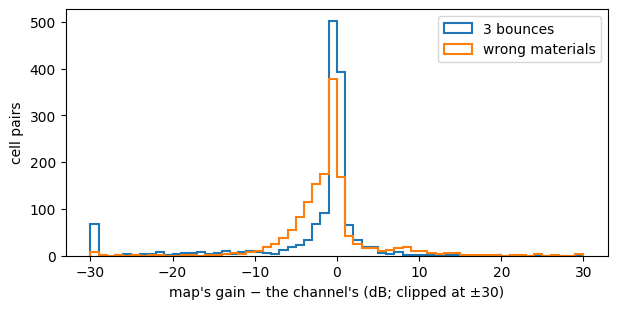

# When the radio map is wrong


<!-- WARNING: THIS FILE WAS AUTOGENERATED! DO NOT EDIT! -->

[Power control without channel knowledge](06_predicted_power.ipynb)
shows that a ray-traced map, with the receiver’s reported cell and
heading, predicts the channel far better than the link’s history. That
assumes the map is the channel. A real map is traced from a model of the
scene, which is never exact: fewer reflections than the real channel
has, approximate wall materials, and none of the small-scale fading on
top.

This example keeps one layout, and gives the transmitter a map that is
exact, traced with too few bounces, or traced with the wrong materials,
with or without fading on top. It compares looking the gain up in the
map against learning from what the links measure: a model that uses the
map as one input among others, and a map built from measurements alone.

``` python
import math

import matplotlib.pyplot as plt
import numpy as np
from sklearn.ensemble import HistGradientBoostingRegressor

from comm_core import *
```

## The channel and the maps

One FindGoal layout (layout 0 of [Power control on new
layouts](07_power_across_layouts.ipynb)). Its channel is Sionna RT’s
with 5 bounces. The maps a transmitter could have instead:

- **Exact:** the channel itself.
- **3 bounces:** traced with fewer reflections, as a cheaper trace would
  be.
- **Wrong materials:** traced with other wall materials than the real
  ones.

Each scenario also comes with or without small-scale fading on top of
the channel, which no map holds: Rayleigh, redrawn whenever an agent
moves, drifting slowly while both stand still.

``` python
data = np.load('data/findgoal_layouts.npz')
k0 = list(data['seeds']).index(0)
CELLS = [tuple(int(v) for v in c) for c in data['cells'][k0]]
IDX = {c: i for i, c in enumerate(CELLS)}
to_gain = lambda a: 10 ** (a.astype(float) / 10)
CHANNEL = to_gain(data['gain_db'][k0])                                  # [rx, tx]
MAPS = {'exact': CHANNEL, '3 bounces': to_gain(data['layout0_depth3_gain_db']),
        'wrong materials': to_gain(data['layout0_materials_gain_db'])}
db = lambda g: 10 * np.log10(np.maximum(g, 1e-30))

pairs = ~np.eye(len(CELLS), dtype=bool)
fig, ax = plt.subplots(figsize=(7, 3.2))
for name in ('3 bounces', 'wrong materials'):
    error = (db(MAPS[name]) - db(CHANNEL))[pairs]
    no_path = (MAPS[name][pairs] <= 1e-14).sum()
    print(f'{name:16s} error {error[np.abs(error) < 50].mean():+5.1f} ± {error[np.abs(error) < 50].std():.1f} dB; '
          f'{no_path} of {pairs.sum()} cell pairs without any path')
    ax.hist(np.clip(error, -30, 30), bins=60, range=(-30, 30), histtype='step', lw=1.5, label=name)
ax.set(xlabel="map's gain − the channel's (dB; clipped at ±30)", ylabel='cell pairs')
ax.legend()
plt.show()
```

    3 bounces        error  -2.8 ± 9.0 dB; 62 of 1482 cell pairs without any path
    wrong materials  error  -1.2 ± 5.8 dB; 0 of 1482 cell pairs without any path



## The agents, and what the transmitter knows

Two agents move at random, as in [Power control on new
layouts](07_power_across_layouts.ipynb). For each directed link and
step, the transmitter knows the link’s last 4 gains, whether it moved
and whether the receiver moved a step ago, and where the receiver was a
step ago with its heading: since then, it has stayed or stepped ahead
(its *possible cells*). From the map, it looks up the gain to the
receiver’s last cell, and the lowest and highest over its possible
cells.

``` python
STEPS, HISTORY = 60, 4
DIRS = [(1, 0), (0, 1), (-1, 0), (0, -1)]

def walk(seed):
    "One episode: per step, both agents' cells and headings."
    rng = np.random.default_rng(seed)
    pos = [CELLS[k] for k in rng.choice(len(CELLS), 2, replace=False)]
    head = [int(h) for h in rng.integers(4, size=2)]
    out = []
    for _ in range(STEPS):
        out.append((tuple(pos), tuple(head)))
        for a in rng.permutation(2):
            action = rng.integers(4)                                     # left, right, forward, nothing
            if action < 2:
                head[a] = (head[a] + (1 if action else -1)) % 4
            elif action == 2:
                ahead = (pos[a][0] + DIRS[head[a]][0], pos[a][1] + DIRS[head[a]][1])
                if ahead in IDX and ahead != pos[1 - a]:
                    pos[a] = ahead
    return out

def fading(episode, seed, rho=0.95):
    "|g_t|² of a pair's Rayleigh fading: redrawn when an agent moves, drifting slowly while both stand still."
    rng = np.random.default_rng(10_000 + seed)
    draw = lambda: (rng.standard_normal() + 1j * rng.standard_normal()) / np.sqrt(2)
    g, out = draw(), []
    for t in range(len(episode)):
        if t and episode[t][0] != episode[t - 1][0]:
            g = draw()
        elif t:
            g = rho * g + np.sqrt(1 - rho ** 2) * draw()
        out.append(abs(g) ** 2)
    return np.array(out)

def samples(seeds, map_name, faded):
    "Per directed link and step: what the transmitter knows (with the map's lookups), and the true gain."
    M, out = MAPS[map_name], []
    for seed in seeds:
        episode = walk(seed)
        fade = fading(episode, seed) if faded else np.ones(len(episode))
        for j, i in ((0, 1), (1, 0)):
            g = [CHANNEL[IDX[cells[i]], IDX[cells[j]]] * f for (cells, _), f in zip(episode, fade)]
            for t in range(HISTORY, len(episode)):
                (now, _), (before, heads), (earlier, _) = episode[t], episode[t - 1], episode[t - 2]
                ahead = (before[i][0] + DIRS[heads[i]][0], before[i][1] + DIRS[heads[i]][1])
                possible = [c for c in (before[i], ahead) if c in IDX and c != now[j]] or [before[i]]
                lookup = [M[IDX[c], IDX[now[j]]] for c in possible]
                out.append(dict(tx=now[j], pair=(now[j], now[i]), possible=possible, past=np.array(g[t - HISTORY:t][::-1]),
                                moved=[float(now[j] != before[j]), float(before[i] != earlier[i])], gain=g[t],
                                map=[M[IDX[before[i]], IDX[now[j]]] if before[i] != now[j] else 1.0, min(lookup), max(lookup)]))
    return out
```

## The predictors

<table>
<colgroup>
<col style="width: 33%" />
<col style="width: 33%" />
<col style="width: 33%" />
</colgroup>
<thead>
<tr>
<th>predictor</th>
<th>uses</th>
<th>how</th>
</tr>
</thead>
<tbody>
<tr>
<td>C3-WM’s</td>
<td>last 4 gains</td>
<td>linear in <code>|h|²</code> (<a
href="https://Ahmed-Khaled-Saleh.github.io/comm-core/power_control.html#fit_gain_predictor"><code>fit_gain_predictor</code></a>,
eq. 24)</td>
</tr>
<tr>
<td>C3-WM’s, in dB</td>
<td>last 4 gains</td>
<td>linear in dB</td>
</tr>
<tr>
<td>map lookup</td>
<td>the map, the receiver’s possible cells</td>
<td>the map’s lowest gain over the possible cells (<a
href="https://Ahmed-Khaled-Saleh.github.io/comm-core/power_control.html#mapchannelinversion"><code>MapChannelInversion</code></a>)</td>
</tr>
<tr>
<td>learned quantile</td>
<td>last 4 gains, moves, the map’s lookups</td>
<td>gradient-boosted trees, 5% quantile of the gain in dB</td>
</tr>
<tr>
<td>measured map</td>
<td>the gains measured in past episodes</td>
<td>each cell pair’s mean gain (dB) over the training episodes; pairs
never measured from a fit in log-distance; the lowest over the possible
cells</td>
</tr>
</tbody>
</table>

The learned quantile treats the map as one input among others: it learns
how far to trust it. The measured map needs no ray tracing at all, only
the layout to stay the same.

``` python
def measured_map(fit):
    "Each cell pair's mean gain in dB over the training transmissions; never measured: a fit in log-distance."
    seen = {}
    for r in fit:
        seen.setdefault(frozenset(r['pair']), []).append(db(r['gain']))
    mean = {k: np.mean(v) for k, v in seen.items()}
    distance = lambda k: math.hypot(*np.subtract(*sorted(k)))
    w = np.polyfit([math.log10(distance(k)) for k in mean], list(mean.values()), 1)
    def gain(a, b):
        k = frozenset((a, b))
        return 10 ** ((mean[k] if k in mean else np.polyval(w, math.log10(math.hypot(a[0] - b[0], a[1] - b[1])))) / 10)
    return gain, len(mean) / (len(CELLS) * (len(CELLS) - 1) / 2)

def predictors(fit):
    "name -> predict(samples) -> ĝ; everything learned from `fit` only."
    y = db(np.array([r['gain'] for r in fit]))
    sequences = [np.r_[r['past'][::-1], r['gain']] for r in fit]
    psi, psi_db = fit_gain_predictor(sequences, history=HISTORY), fit_gain_predictor(sequences, history=HISTORY, domain='db')
    X = lambda rs: np.c_[db(np.stack([r['past'] for r in rs])), db(np.array([r['map'] for r in rs])), [r['moved'] for r in rs]]
    quantile = HistGradientBoostingRegressor(loss='quantile', quantile=0.05, max_iter=400, learning_rate=0.05,
                                             early_stopping=False, random_state=0).fit(X(fit), y)
    measured, coverage = measured_map(fit)
    return {
        "C3-WM's": lambda rs: np.array([max(psi(r['past']), 0.0) for r in rs]),
        "C3-WM's, in dB": lambda rs: np.array([psi_db(r['past']) for r in rs]),
        'map lookup': lambda rs: np.array([r['map'][1] for r in rs]),
        'learned quantile': lambda rs: 10 ** (quantile.predict(X(rs)) / 10),
        'measured map': lambda rs: np.array([min(measured(r['tx'], c) for c in r['possible']) for r in rs]),
    }, coverage
```

## Judging a predictor

As in [Power control on new layouts](07_power_across_layouts.ipynb): the
share of the servable transmissions (`g ≥ g_min = Γσ²/ρ_max`) reaching
`Γ`, and the mean power relative to perfect CSI’s. The margin `κ` and
the scheduling threshold `τ` (withhold when `ρ̂ > τ ρ_max`) are chosen on
calibration episodes, the cheapest pair reaching the target there, and
the predictors are judged on test episodes. `Γ = 10 dB`, `σ² = −94 dBm`,
`ρ_max = 20 dBm`.

``` python
SNR_TARGET_DB, NOISE_DBM, MAX_POWER_DBM = 10.0, -94.0, 20.0
G_MIN = 10 ** ((SNR_TARGET_DB + NOISE_DBM - MAX_POWER_DBM) / 10)
MARGINS = np.arange(-10, 40.01, 0.25)
TAUS = (0.0, 1, 2, 3, 4, 5, 6, 8, 10, 12, 15, 20, 25, 30, math.inf)

def outcome(estimate, gain, tau):
    "Per margin: the share of the servable transmissions reaching Γ, the mean power (× perfect CSI's)."
    max_power, servable, need = 1 / G_MIN, gain >= G_MIN, 1 / gain
    rho = 10 ** (MARGINS[:, None] / 10) / np.maximum(estimate, 1e-30)[None, :]
    sent = rho <= max_power * 10 ** (tau / 10) if np.isfinite(tau) else np.ones_like(rho, bool)
    power = np.where(sent, np.minimum(rho, max_power), 0)
    reached = sent & (power >= need * (1 - 1e-9))
    return reached[:, servable].mean(1), power.mean(1) / np.where(servable, need, 0).mean()

def deploy(cal, cal_gain, test, test_gain, target, taus=TAUS):
    "κ and τ chosen on the calibration episodes (the cheapest reaching `target`, else the most reliable); on the test ones."
    best = None
    for tau in taus:
        reached, power = outcome(cal, cal_gain, tau)
        for k in range(len(MARGINS)):
            key = (reached[k] >= target, -power[k] if reached[k] >= target else reached[k])
            if best is None or key > best[0]:
                best = (key, tau, k)
    (met, _), tau, k = best
    reached, power = outcome(test, test_gain, tau)
    return dict(reached=reached[k], power=power[k], met=met, tau=tau, margin=MARGINS[k])
```

## The comparison

Fit on 200 episodes, calibration on 60 others, test on 60 more:

``` python
SCENARIOS = {'exact map': ('exact', False), 'map traced with 3 bounces': ('3 bounces', False),
             'map with wrong materials': ('wrong materials', False), 'exact map, fading not in it': ('exact', True),
             '3 bounces, and fading': ('3 bounces', True)}
FIT, CALIBRATION, TEST = range(0, 200), range(200, 260), range(1000, 1060)
results = {}
for scenario, (map_name, faded) in SCENARIOS.items():
    fit, cal, test = samples(FIT, map_name, faded), samples(CALIBRATION, map_name, faded), samples(TEST, map_name, faded)
    gains = lambda rs: np.array([r['gain'] for r in rs])
    preds, coverage = predictors(fit)
    results[scenario] = {name: {t: [deploy(p(cal), gains(cal), p(test), gains(test), t, taus=taus) for taus in ((0.0,), TAUS)]
                                for t in (0.95, 0.99)} for name, p in preds.items()}
    print(f'\n{scenario}: {100 * (gains(test) >= G_MIN).mean():.1f}% of the test transmissions servable; '
          f'measured map: {100 * coverage:.0f}% of the cell pairs measured')
    print(f"{'':18s}{'withhold (τ = 0)':>34s}{'tuned τ':>34s}")
    print(f"{'':18s}" + ''.join(f'{100 * t:>16.0f}%' for _ in range(2) for t in (0.95, 0.99)))
    for name, r in results[scenario].items():
        row = [r[t][rule] for rule in (0, 1) for t in (0.95, 0.99)]
        print(f'{name:18s}' + ''.join(f"{100 * d['reached']:8.1f}% {d['power']:5.1f}×{' ' if d['met'] else '✗'}" for d in row))
```

    exact map: 86.2% of the test transmissions servable; measured map: 95% of the cell pairs measured
                                        withhold (τ = 0)                           tuned τ
                                    95%              99%              95%              99%
    C3-WM's               97.7%  11.0×     98.8%  14.6×✗    97.7%  11.0×     98.8%  14.6×✗
    C3-WM's, in dB        89.0%   0.9×✗    89.0%   0.9×✗    96.2%   4.1×     98.6%  10.5× 
    map lookup            97.9%   1.0×     97.9%   1.0×✗    97.9%   1.0×     99.7%   4.4× 
    learned quantile      97.1%   1.0×✗    97.1%   1.0×✗    97.8%   1.3×     99.6%   4.4× 
    measured map          91.3%   1.0×✗    91.3%   1.0×✗    97.9%   3.8×     99.7%   7.6× 

    map traced with 3 bounces: 86.2% of the test transmissions servable; measured map: 95% of the cell pairs measured
                                        withhold (τ = 0)                           tuned τ
                                    95%              99%              95%              99%
    C3-WM's               97.7%  11.0×     98.8%  14.6×✗    97.7%  11.0×     98.8%  14.6×✗
    C3-WM's, in dB        89.0%   0.9×✗    89.0%   0.9×✗    96.2%   4.1×     98.6%  10.5× 
    map lookup            87.6%   1.0×✗    87.6%   1.0×✗    95.9%   6.8×     98.5%   7.3× 
    learned quantile      88.8%   0.6×✗    88.8%   0.6×✗    96.8%   4.0×     99.0%   6.2× 
    measured map          91.3%   1.0×✗    91.3%   1.0×✗    97.9%   3.8×     99.7%   7.6× 

    map with wrong materials: 86.2% of the test transmissions servable; measured map: 95% of the cell pairs measured
                                        withhold (τ = 0)                           tuned τ
                                    95%              99%              95%              99%
    C3-WM's               97.7%  11.0×     98.8%  14.6×✗    97.7%  11.0×     98.8%  14.6×✗
    C3-WM's, in dB        89.0%   0.9×✗    89.0%   0.9×✗    96.2%   4.1×     98.6%  10.5× 
    map lookup            90.9%   1.5×✗    90.9%   1.5×✗    98.2%   5.7×     99.2%   6.6× 
    learned quantile      90.5%   0.7×✗    90.5%   0.7×✗    97.6%   3.7×     99.6%   6.2× 
    measured map          91.3%   1.0×✗    91.3%   1.0×✗    97.9%   3.8×     99.7%   7.6× 

    exact map, fading not in it: 85.9% of the test transmissions servable; measured map: 95% of the cell pairs measured
                                        withhold (τ = 0)                           tuned τ
                                    95%              99%              95%              99%
    C3-WM's               96.0%   8.3×     97.2%   9.9×✗    95.7%   7.9×     97.4%   9.9×✗
    C3-WM's, in dB        83.8%   0.9×✗    83.8%   0.9×✗    95.3%   4.7×     98.7%  10.1× 
    map lookup            83.4%   1.5×✗    83.4%   1.5×✗    95.5%   5.5×     98.7%   8.7× 
    learned quantile      86.0%   1.1×✗    86.0%   1.1×✗    96.5%   4.5×     98.8%   7.5× 
    measured map          83.3%   1.8×✗    83.3%   1.8×✗    95.9%   6.1×     99.0%   9.4× 

    3 bounces, and fading: 85.9% of the test transmissions servable; measured map: 95% of the cell pairs measured
                                        withhold (τ = 0)                           tuned τ
                                    95%              99%              95%              99%
    C3-WM's               96.0%   8.3×     97.2%   9.9×✗    95.7%   7.9×     97.4%   9.9×✗
    C3-WM's, in dB        83.8%   0.9×✗    83.8%   0.9×✗    95.3%   4.7×     98.7%  10.1× 
    map lookup            79.6%   1.3×✗    79.6%   1.3×✗    93.9%   7.2×     98.5%   8.9× 
    learned quantile      83.7%   1.0×✗    83.7%   1.0×✗    96.3%   4.9×     98.8%   8.0× 
    measured map          83.3%   1.8×✗    83.3%   1.8×✗    95.9%   6.1×     99.0%   9.4× 

- **With an exact map, the lookup reaches 95% at perfect CSI’s power,**
  with no margin: the receiver’s actual cell is one of its possible
  cells, so the lookup never overestimates. 99% costs 4.4×, because of
  the receiver’s position, not the map. In about 2% of the
  transmissions, one possible cell is beyond the budget while the cell
  the receiver went to is not. Sending those takes a large threshold
  `τ`, and then the transmitter also spends `ρ_max` on the 14% of
  transmissions that can’t be served.
- **An imperfect map makes the lookup the worst map-based predictor.**
  Traced with 3 bounces (−2.8 ± 9.0 dB off, and 62 cell pairs without
  any path), it needs 6.8× for 95%. With the wrong materials (−1.2 ± 5.8
  dB off), 5.7×. The learned quantile, given the same map, needs 4.0×
  and 3.7×: it learns how far to trust the map.
- **The measured map needs no ray tracing:** 3.8× for 95% and 7.6× for
  99%, with 95% of the cell pairs measured in 200 episodes. That is as
  good as a wrong map used well. It holds only while the layout stays
  the same.
- **Fading the map doesn’t hold costs everyone,** the exact map
  included: 4.5–7.2× for 95%, 7.5–10× for 99%. The learned quantile is
  the cheapest at 99%; at 95%, it is within 5% of the cheapest.
- **C3-WM’s predictor** (linear in `|h|²`) never reaches 99%, and needs
  8–11× for 95%. Withholding as soon as `ρ̂ > ρ_max` (`τ = 0`) meets 95%
  on the calibration episodes only with the exact map’s lookup, and with
  C3-WM’s predictor, which rarely predicts more than `ρ_max`.

## In short

- **An exact map is worth using directly:** the lookup over the
  receiver’s possible cells needs no margin. Most of what remains is the
  receiver’s position, which a fresher report would reduce.
- **An imperfect map is worth learning from, not looking up.** Given the
  map as an input, a learned quantile model is the cheapest at 99% in
  every scenario with an imperfect map or with fading, and within about
  5% of the cheapest at 95%.
- **Without any ray tracing, measure the map,** if the layout stays the
  same. When it changes from episode to episode, see [Power control on
  new layouts](07_power_across_layouts.ipynb).

``` python
tuned = lambda scenario, name, target: results[scenario][name][target][1]
assert tuned('exact map', 'map lookup', 0.95)['power'] < 1.2                               # an exact map: no margin needed
for scenario in ('map traced with 3 bounces', 'map with wrong materials', 'exact map, fading not in it', '3 bounces, and fading'):
    assert tuned(scenario, 'learned quantile', 0.99)['power'] < tuned(scenario, 'map lookup', 0.99)['power']   # learn from a wrong map
    assert tuned(scenario, 'learned quantile', 0.95)['power'] < tuned(scenario, 'map lookup', 0.95)['power']
assert not any(tuned(s, "C3-WM's", 0.99)['met'] for s in SCENARIOS)
```
