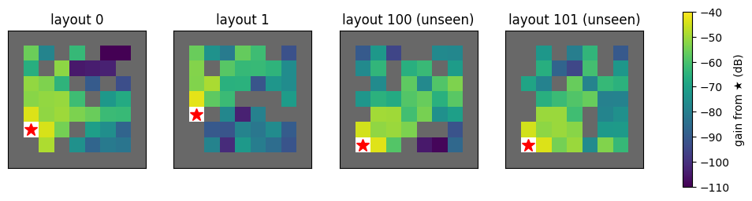
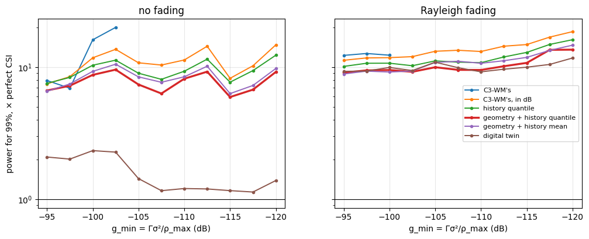

# Power control on new layouts


<!-- WARNING: THIS FILE WAS AUTOGENERATED! DO NOT EDIT! -->

[Power control without channel knowledge](06_predicted_power.ipynb)
compares predictors in one fixed room. In an application, the layout
changes from episode to episode and the agents start anywhere, so a
predictor has to work in layouts it has never seen. This example takes
the same link, C3-WM’s (49 codebook tokens of 8 bits, uncoded BPSK,
channel inversion to a target SNR `Γ`), in ray-traced layouts of
MultiGrid’s FindGoal, and asks how to set the power so that a chosen
share `1 − ε` of the transmissions reach `Γ`, with as little power as
possible:

``` text
minimize ρ   subject to   P(SNR(ρ) ≥ Γ) ≥ 1 − ε,   0 ≤ ρ ≤ ρ_max
```

The transmitter does not know the current gain `g = |h|²`. It predicts
it (`ĝ`) from what it knows, and sends at `ρ̂ = κ Γσ²/ĝ`, with a margin
`κ` against the prediction’s errors. When `ρ̂` exceeds `ρ_max`, it either
withholds the transmission or sends at `ρ_max` anyway.

The questions: what to predict from (the link’s past gains, the agents’
moves, the layout’s geometry, a ray-traced map), how to set the margin
for layouts not seen yet, and when to withhold. Everything is fit on
some layouts, tuned on others, and judged on layouts neither saw.

``` python
import math

import matplotlib.pyplot as plt
import numpy as np
from sklearn.ensemble import HistGradientBoostingRegressor

from comm_core import *
```

## The layouts

40 layouts of MultiGrid’s FindGoal (9 × 9, walls scattered inside), each
ray-traced with Sionna RT at 2.4 GHz (5 bounces) between every pair of
free cells. The file holds each pair’s gain `|h|²` in dB, the free cells
and the wall grid. It was made with stable-marl’s `trace_layouts`
(Sionna RT through
[`trace_paths`](https://Ahmed-Khaled-Saleh.github.io/comm-core/sionna_rt.html#trace_paths)),
then the gains converted to dB:

``` python
from stable_marl.envs.multigrid.sionna_export import trace_layouts

trace_layouts('MultiGrid-FindGoal-15x15-v0', [*range(30), *range(100, 110)], 'layouts',
              env_kwargs=dict(agents=2, size=9, num_obstacles=0), frequency=2.4e9, max_depth=5)
```

``` python
data = np.load('data/findgoal_layouts.npz')
DIRS = [(1, 0), (0, 1), (-1, 0), (0, -1)]

class Layout:
    "One ray-traced layout: the gain between any two free cells, and the walls between them."
    def __init__(self, k):
        self.seed = int(data['seeds'][k])
        self.cells = [tuple(int(v) for v in c) for c in data['cells'][k]]
        self.idx = {c: i for i, c in enumerate(self.cells)}
        self.G = 10 ** (data['gain_db'][k].astype(float) / 10)               # G[rx, tx]
        self.walls = data['walls'][k]                                       # walls[x, y]

    def gain(self, tx, rx):
        return self.G[self.idx[rx], self.idx[tx]]

    def geometry(self, a, b):
        "Distance (cells) and the number of wall cells the straight line between the two cell centres crosses."
        n = max(int(abs(a[0] - b[0]) + abs(a[1] - b[1])) * 4, 1)
        xs, ys = np.linspace(a[0], b[0], n + 1), np.linspace(a[1], b[1], n + 1)
        crossed = {(int(round(x)), int(round(y))) for x, y in zip(xs, ys)} - {a, b}
        return math.hypot(a[0] - b[0], a[1] - b[1]), int(sum(self.walls[c] for c in crossed))

layouts = {int(s): Layout(k) for k, s in enumerate(data['seeds'])}
FIT, CALIBRATION, TEST = range(0, 24), range(24, 30), range(100, 110)
print(f'{len(layouts)} layouts, {len(layouts[0].cells)} free cells each')
```

    40 layouts, 39 free cells each

``` python
fig, axes = plt.subplots(1, 4, figsize=(13, 3.4))
for ax, seed in zip(axes, (0, 1, 100, 101)):
    lay, tx = layouts[seed], layouts[seed].cells[0]
    img = np.full(lay.walls.shape, np.nan)
    for c in lay.cells:
        img[c] = 10 * np.log10(lay.gain(tx, c)) if c != tx else np.nan
    im = ax.imshow(img.T, origin='lower', cmap='viridis', vmin=-110, vmax=-40)
    ax.imshow(np.where(lay.walls.T, 1.0, np.nan), origin='lower', cmap='Greys', vmin=0, vmax=1.5)
    ax.plot(*tx, 'r*', ms=12)
    ax.set(title=f'layout {seed}' + (' (unseen)' if seed >= 100 else ''), xticks=[], yticks=[])
fig.colorbar(im, ax=axes, label='gain from ★ (dB)', shrink=0.85)
plt.show()
```



## The agents

Two agents move at random, as with a random policy in FindGoal: at each
step each one turns left, turns right, steps forward (unless a wall or
the other agent is there) or does nothing. They start in distinct random
cells with random headings. (FindGoal also has a goal, which takes an
agent off the grid; there is none here.)

``` python
STEPS, HISTORY, ROLLOUTS = 60, 4, 5

def walk(lay, seed):
    "One episode: per step, both agents' cells and headings."
    rng = np.random.default_rng(seed)
    free = set(lay.cells)
    pos = [lay.cells[k] for k in rng.choice(len(lay.cells), 2, replace=False)]
    head = [int(h) for h in rng.integers(4, size=2)]
    out = []
    for _ in range(STEPS):
        out.append((tuple(pos), tuple(head)))
        for a in rng.permutation(2):
            action = rng.integers(4)                                     # left, right, forward, nothing
            if action < 2:
                head[a] = (head[a] + (1 if action else -1)) % 4
            elif action == 2:
                ahead = (pos[a][0] + DIRS[head[a]][0], pos[a][1] + DIRS[head[a]][1])
                if ahead in free and ahead != pos[1 - a]:
                    pos[a] = ahead
    return out
```

## What the transmitter knows

For each directed link and step `t ≥ 4`, what transmitter `j` knows when
it sends to `i`:

- **The link’s last 4 gains,** fed back by the receiver (C3-WM’s `x̃`).
- **Whether anyone moved:** the transmitter itself, this step (its own
  move), and the receiver, a step ago (its report arrives with a step’s
  delay, like the gains).
- **Where the receiver was a step ago, and its heading.** Since then, it
  has stayed or stepped ahead: the receiver’s *possible cells*.
- **The layout’s walls**, for the geometry between the two agents: the
  distance and the number of walls in between.

Optionally, small-scale fading on top of the ray-traced gain: Rayleigh,
redrawn whenever an agent moves (it moves many wavelengths), and
drifting slowly while both stand still.

``` python
db = lambda g: 10 * np.log10(np.maximum(g, 1e-30))

def fading(episode, seed, rho=0.95):
    "|g_t|² of a pair's Rayleigh fading: redrawn when an agent moves, drifting slowly while both stand still."
    rng = np.random.default_rng(10_000 + seed)
    draw = lambda: (rng.standard_normal() + 1j * rng.standard_normal()) / np.sqrt(2)
    g, out = draw(), []
    for t in range(len(episode)):
        if t and episode[t][0] != episode[t - 1][0]:
            g = draw()
        elif t:
            g = rho * g + np.sqrt(1 - rho ** 2) * draw()
        out.append(abs(g) ** 2)
    return np.array(out)

def samples(seeds, faded):
    "Per directed link and step: what the transmitter knows, and the true gain."
    out = []
    for seed in seeds:
        lay = layouts[seed]
        for k in range(ROLLOUTS):
            episode = walk(lay, 1000 * seed + k)
            fade = fading(episode, 1000 * seed + k) if faded else np.ones(len(episode))
            for j, i in ((0, 1), (1, 0)):
                g = [lay.gain(cells[j], cells[i]) * f for (cells, _), f in zip(episode, fade)]
                for t in range(HISTORY, len(episode)):
                    (now, _), (before, heads), (earlier, _) = episode[t], episode[t - 1], episode[t - 2]
                    ahead = (before[i][0] + DIRS[heads[i]][0], before[i][1] + DIRS[heads[i]][1])
                    possible = [c for c in (before[i], ahead) if c in lay.idx and c != now[j]] or [before[i]]
                    out.append(dict(lay=lay, tx=now[j], rx=now[i], possible=possible, past=np.array(g[t - HISTORY:t][::-1]),
                                    moved=[float(now[j] != before[j]), float(before[i] != earlier[i])], gain=g[t]))
    return out
```

## The predictors

Each predicts the gain `ĝ` of the current transmission:

<table>
<colgroup>
<col style="width: 33%" />
<col style="width: 33%" />
<col style="width: 33%" />
</colgroup>
<thead>
<tr>
<th>predictor</th>
<th>uses</th>
<th>model</th>
</tr>
</thead>
<tbody>
<tr>
<td>C3-WM’s</td>
<td>last 4 gains</td>
<td>linear in <code>|h|²</code> (<a
href="https://Ahmed-Khaled-Saleh.github.io/comm-core/power_control.html#fit_gain_predictor"><code>fit_gain_predictor</code></a>,
eq. 24)</td>
</tr>
<tr>
<td>C3-WM’s, in dB</td>
<td>last 4 gains</td>
<td>linear in dB
(<code>fit_gain_predictor(..., domain='db')</code>)</td>
</tr>
<tr>
<td>history quantile</td>
<td>last 4 gains, moves</td>
<td>gradient-boosted trees, 5% quantile of the gain in dB</td>
</tr>
<tr>
<td>geometry + history quantile</td>
<td>the same, and the geometry to each possible cell</td>
<td>gradient-boosted trees, 5% quantile; the lowest over the possible
cells</td>
</tr>
<tr>
<td>geometry + history mean</td>
<td>the same</td>
<td>gradient-boosted trees, mean (in dB); the lowest over the possible
cells</td>
</tr>
<tr>
<td>digital twin</td>
<td>a ray-traced map of the layout</td>
<td>the map’s lowest gain over the possible cells</td>
</tr>
</tbody>
</table>

The quantile models predict a gain the true one exceeds 95% of the time:
they are cautious by construction. The geometry models are trained on
the receiver’s actual cell, and used on each of its possible cells. The
digital twin needs every new layout ray-traced; it is the reference.

``` python
def features(r, cell):
    distance, walls = r['lay'].geometry(r['tx'], cell)
    return [math.log10(max(distance, 0.5)), distance, walls] + list(db(r['past'])) + r['moved']

def lowest(model):
    "The model's prediction for each of the receiver's possible cells: the lowest."
    def predict(rs):
        pairs = [(k, c) for k, r in enumerate(rs) for c in r['possible']]
        out = np.full(len(rs), np.inf)
        np.minimum.at(out, [k for k, _ in pairs], model.predict(np.array([features(rs[k], c) for k, c in pairs])))
        return 10 ** (out / 10)
    return predict

def predictors(fit):
    "name -> predict(samples) -> ĝ; everything learned from `fit` only."
    y = db(np.array([r['gain'] for r in fit]))
    sequences = [np.r_[r['past'][::-1], r['gain']] for r in fit]
    psi, psi_db = fit_gain_predictor(sequences, history=HISTORY), fit_gain_predictor(sequences, history=HISTORY, domain='db')
    trees = lambda **kw: HistGradientBoostingRegressor(max_iter=400, learning_rate=0.05, early_stopping=False, random_state=0, **kw)
    history = lambda rs: np.c_[db(np.stack([r['past'] for r in rs])), [r['moved'] for r in rs]]
    quantile = trees(loss='quantile', quantile=0.05).fit(history(fit), y)
    X = np.array([features(r, r['rx']) for r in fit])
    return {
        "C3-WM's": lambda rs: np.array([max(psi(r['past']), 0.0) for r in rs]),
        "C3-WM's, in dB": lambda rs: np.array([psi_db(r['past']) for r in rs]),
        'history quantile': lambda rs: 10 ** (quantile.predict(history(rs)) / 10),
        'geometry + history quantile': lowest(trees(loss='quantile', quantile=0.05).fit(X, y)),
        'geometry + history mean': lowest(trees(loss='squared_error').fit(X, y)),
        'digital twin': lambda rs: np.array([min(r['lay'].gain(r['tx'], c) for c in r['possible']) for r in rs]),
    }
```

## Judging a predictor

A transmission is *servable* if perfect CSI could deliver it: its gain
is at least `g_min = Γσ²/ρ_max`. A predictor is judged by two numbers:

- **Reliability:** the share of the servable transmissions that reach
  `Γ`.
- **Power:** the mean transmit power, relative to perfect CSI’s, which
  spends exactly `Γσ²/g` on each servable transmission and nothing on
  the others.

Only high targets (95% and 99%) are compared: at lower ones, a predictor
can look cheap by giving up the weakest links, which take most of the
power.

Each predictor is deployed with a margin `κ`, `ρ̂ = 10^(κ/10) Γσ²/ĝ`, and
a scheduling threshold `τ`: the transmission is sent if
`ρ̂ ≤ 10^(τ/10) ρ_max`, at `min(ρ̂, ρ_max)`, and withheld otherwise.
`τ = 0` is C3-WM’s rule (`δ = 1(ρ̂ ≤ ρ_max)`); `τ = ∞` never withholds
(best effort). `κ`, and `τ` when it is tuned, are chosen on calibration
layouts: the cheapest pair that reaches the target there. The link
budget: `Γ = 10 dB`, `σ² = −94 dBm`, `ρ_max = 20 dBm`.

``` python
SNR_TARGET_DB, NOISE_DBM, MAX_POWER_DBM = 10.0, -94.0, 20.0
G_MIN = 10 ** ((SNR_TARGET_DB + NOISE_DBM - MAX_POWER_DBM) / 10)      # Γσ²/ρ_max
MARGINS = np.arange(-10, 40.01, 0.25)                                 # κ, dB
TAUS = (0.0, 1, 2, 3, 4, 5, 6, 8, 10, 12, 15, 20, 25, 30, math.inf)    # τ, dB
print(f'g_min = {db(G_MIN):.0f} dB')

def outcome(estimate, gain, g_min=G_MIN, tau=0.0):
    """Per margin κ: the share of the servable transmissions reaching Γ, the mean power (× perfect CSI's), the share
    withheld, and the per-transmission power (in units of Γσ²). τ: withhold when ρ̂ > τ ρ_max (dB); inf: never."""
    max_power, servable, need = 1 / g_min, gain >= g_min, 1 / gain
    rho = 10 ** (MARGINS[:, None] / 10) / np.maximum(estimate, 1e-30)[None, :]
    sent = rho <= max_power * 10 ** (tau / 10) if np.isfinite(tau) else np.ones_like(rho, bool)
    power = np.where(sent, np.minimum(rho, max_power), 0)
    reached = sent & (power >= need * (1 - 1e-9))
    perfect = np.where(servable, need, 0).mean()
    return reached[:, servable].mean(1), power.mean(1) / perfect, 1 - sent.mean(1), power

def deploy(name, faded, target, g_min=G_MIN, taus=(0.0,)):
    """κ (and τ, from `taus`) chosen on the calibration layouts, the cheapest reaching `target` there (else the most
    reliable); then used on the unseen layouts."""
    (cal, cal_gain), (test, test_gain) = runs[faded][name]
    best = None
    for tau in taus:
        reached, power, _, _ = outcome(cal, cal_gain, g_min, tau)
        for k in range(len(MARGINS)):
            key = (reached[k] >= target, -power[k] if reached[k] >= target else reached[k])
            if best is None or key > best[0]:
                best = (key, tau, k)
    (met, _), tau, k = best
    reached, power, withheld, per_transmission = outcome(test, test_gain, g_min, tau)
    return dict(reached=reached[k], power=power[k], withheld=withheld[k], margin=MARGINS[k], tau=tau, met=met,
                per_transmission=per_transmission[k])
```

    g_min = -104 dB

## On new layouts

The models are fit on layouts 0–23, the margins are chosen on layouts
24–29, and everything is judged on layouts 100–109, which neither saw.
Without fading, then with it:

``` python
runs = {}
for faded in (False, True):
    fit, cal, test = samples(FIT, faded), samples(CALIBRATION, faded), samples(TEST, faded)
    gains = lambda rs: np.array([r['gain'] for r in rs])
    runs[faded] = {name: ((p(cal), gains(cal)), (p(test), gains(test))) for name, p in predictors(fit).items()}
    print(f"{'Rayleigh fading' if faded else 'no fading'}: {len(fit)} / {len(cal)} / {len(test)} transmissions "
          f"(fit / calibration / unseen); {100 * (gains(test) >= G_MIN).mean():.1f}% of the unseen ones servable")
```

    no fading: 13440 / 3360 / 5600 transmissions (fit / calibration / unseen); 93.7% of the unseen ones servable
    Rayleigh fading: 13440 / 3360 / 5600 transmissions (fit / calibration / unseen); 91.9% of the unseen ones servable

``` python
def table(faded, rules=(((0.0,), 'withhold (τ = 0)'), ((math.inf,), 'best effort (τ = ∞)'), (TAUS, 'tuned τ')), targets=(0.95, 0.99)):
    print(f"{'Rayleigh fading' if faded else 'no fading'}: reliability reached on the unseen layouts, "
          f"power (× perfect CSI); ✗: target not reached on the calibration layouts")
    print(f"{'':28s}" + ''.join(f'{label:>34s}' for _, label in rules))
    print(f"{'':28s}" + ''.join(f'{100 * t:>16.0f}%' for _ in rules for t in targets))
    for name in runs[faded]:
        row = [deploy(name, faded, t, taus=taus) for taus, _ in rules for t in targets]
        print(f'{name:28s}' + ''.join(f"{100 * d['reached']:8.1f}% {d['power']:5.1f}×{' ' if d['met'] else '✗'}" for d in row))

table(False)
print()
table(True)
```

    no fading: reliability reached on the unseen layouts, power (× perfect CSI); ✗: target not reached on the calibration layouts
                                                  withhold (τ = 0)               best effort (τ = ∞)                           tuned τ
                                              95%              99%              95%              99%              95%              99%
    C3-WM's                         96.6%   6.1×     98.1%  13.7×✗    96.5%   5.2×     98.2%  13.8×✗    96.5%   5.2×     98.2%  13.8×✗
    C3-WM's, in dB                  87.9%   1.6×✗    87.9%   1.6×✗    95.0%   4.5×     99.2%  10.1×     94.7%   3.2×     99.1%   9.8× 
    history quantile                89.9%   1.1×✗    89.9%   1.1×✗    95.4%   4.4×     98.9%   8.2×     94.8%   3.7×     98.9%   8.2× 
    geometry + history quantile     92.2%   1.3×✗    92.2%   1.3×✗    94.9%   4.0×     99.0%   6.8×     94.4%   2.0×     99.0%   6.8× 
    geometry + history mean         89.1%   1.4×✗    89.1%   1.4×✗    94.3%   4.0×     99.0%   7.7×     94.6%   2.8×     99.0%   7.7× 
    digital twin                    97.7%   1.1×     98.6%   1.1×✗   100.0%   3.4×    100.0%   3.4×     97.7%   1.1×     98.9%   1.5× 

    Rayleigh fading: reliability reached on the unseen layouts, power (× perfect CSI); ✗: target not reached on the calibration layouts
                                                  withhold (τ = 0)               best effort (τ = ∞)                           tuned τ
                                              95%              99%              95%              99%              95%              99%
    C3-WM's                         93.0%   3.1×     97.3%   9.2×✗    93.0%   3.1×     97.3%   9.2×✗    93.0%   3.1×     97.3%   9.2×✗
    C3-WM's, in dB                  86.8%   1.6×✗    86.8%   1.6×✗    95.4%   6.1×     99.3%  12.3×     95.4%   5.1×     99.2%  12.5× 
    history quantile                85.9%   1.6×✗    85.9%   1.6×✗    95.2%   6.1×     99.0%  10.7×     95.2%   5.2×     99.0%  10.7× 
    geometry + history quantile     86.6%   1.5×✗    86.6%   1.5×✗    94.8%   5.7×     99.2%   9.5×     94.5%   4.2×     99.2%   9.5× 
    geometry + history mean         87.2%   1.7×✗    87.2%   1.7×✗    95.3%   5.7×     99.3%  10.5×     94.9%   4.1×     99.2%   9.9× 
    digital twin                    84.4%   1.7×✗    84.4%   1.7×✗    94.8%   6.5×     99.2%   9.7×     94.5%   5.0×     99.2%   9.8× 

- **C3-WM’s predictor can’t be made reliable.** Fit on `|h|²`, it
  overestimates weak links (the fit is dominated by the strong ones),
  and a margin can’t fix an error that depends on the link’s strength:
  it never reaches 99%. Fit in dB, the same linear predictor is
  unbiased, and reaches both targets.
- **Withholding as soon as `ρ̂ > ρ_max` (`τ = 0`) caps the reliability of
  a cautious predictor.** None of the learned ones reaches 95% that way,
  except C3-WM’s fit on `|h|²` without fading, which rarely predicts
  more than `ρ_max` (it is optimistic about weak links, and fails them
  instead). The margin that rescues underestimated transmissions also
  pushes others over `ρ_max`, where they are withheld although they
  would have succeeded.
- **The margins transfer.** Chosen on 6 layouts, they land within 0.7
  percentage points of the target on the 10 unseen ones.
- **The layout’s geometry helps.** At 99% without fading, the geometry +
  history quantile needs 6.8× perfect CSI’s power, the history alone
  8.2×, C3-WM’s in dB 9.8×.
- **Fading levels the field.** With fading, every predictor needs 10–12×
  for 99%, the digital twin included: the fading is redrawn whenever an
  agent moves, so no one can predict it, and its unpredictable part sets
  the cost. Without fading, the digital twin’s map is exact and it needs
  1.5×.
- **Tuning `τ` pays at 95%** (2.0× instead of 4.0× for the geometry
  model without fading). At 99%, the tuned `τ` is large or infinite, and
  the power within 6% of best effort’s: to lose only 1%, little can be
  withheld.

## The link budget

`Γ`, `σ²` and `ρ_max` matter only through `g_min = Γσ²/ρ_max`, the
weakest gain a link can have and still be served: raising `Γ` by 3 dB is
the same as lowering `ρ_max` by 3 dB. The power each predictor needs for
99%, with the threshold `τ` tuned, from a tight budget (left) to a loose
one:

``` python
G_SWEEP_DB = np.arange(-95, -120.1, -2.5)
fig, axes = plt.subplots(1, 2, figsize=(12, 4.2), sharey=True)
for ax, faded in zip(axes, (False, True)):
    for name in runs[faded]:
        power = [deploy(name, faded, 0.99, 10 ** (g / 10), taus=TAUS) for g in G_SWEEP_DB]
        ax.plot(G_SWEEP_DB, [d['power'] if d['met'] else np.nan for d in power], 'o-', ms=3,
                lw=2.4 if name == 'geometry + history quantile' else 1.4, label=name)
    ax.axhline(1, color='k', lw=0.8)
    ax.set(title='Rayleigh fading' if faded else 'no fading', xlabel='g_min = Γσ²/ρ_max (dB)', yscale='log',
           xlim=(G_SWEEP_DB[0] + 1, G_SWEEP_DB[-1] - 1))
    ax.grid(alpha=0.3)
axes[0].set_ylabel('power for 99%, × perfect CSI')
axes[1].legend(fontsize=8)
plt.show()
```



Without fading, the learned predictors (C3-WM’s aside) need 6–15×
perfect CSI’s power for 99%, and the digital twin 1.1–2.3×. With fading,
all of them need 9–18×, and the twin’s advantage is gone. C3-WM’s
predictor reaches 99% only on the tightest budgets, where the weak links
it overestimates are not servable anyway. The geometry + history models
are the cheapest learned ones over the whole range.

## What the agents receive

Reaching `Γ` is not the same as arriving intact. A message is 49 tokens
of 8 bits over uncoded BPSK, so at the SNR it gets, each bit is wrong
with probability `Q(√(2 SNR))`. With the margins chosen above, the share
of the servable messages that arrive with no bit error, and the share of
wrong tokens in those sent, for two targets `Γ` (at the same `g_min`, so
with `ρ_max` scaled along: the reliability results above don’t change):

``` python
erfc = np.vectorize(math.erfc)
TOKENS, BITS = 49, 8

def received(power, gain, snr_target_db):
    "(error-free share of the servable messages, wrong-token share in the servable messages sent)."
    servable, sent = gain >= G_MIN, power > 0
    ber = 0.5 * erfc(np.sqrt(10 ** (snr_target_db / 10) * power * gain))
    clean = np.where(sent, (1 - ber) ** (TOKENS * BITS), 0)[servable].mean()
    return clean, (1 - (1 - ber[sent & servable]) ** BITS).mean()

for faded in (False, True):
    gain = runs[faded]['digital twin'][1][1]
    print(f"{'Rayleigh fading' if faded else 'no fading'}, tuned τ, target 99%:   error-free / wrong tokens")
    print(f"{'':28s}{'Γ = 7 dB':>22s}{'Γ = 10 dB':>22s}")
    exact = np.where(gain >= G_MIN, 1 / gain, 0)
    print(f"{'perfect CSI (exactly Γ)':28s}" + ''.join(f'{100 * c:12.1f}% {100 * w:6.2f}%  ' for c, w in (received(exact, gain, s) for s in (7, 10))))
    for name in runs[faded]:
        d = deploy(name, faded, 0.99, taus=TAUS)
        print(f'{name:28s}' + ''.join(f'{100 * c:12.1f}% {100 * w:6.2f}%  ' for c, w in (received(d["per_transmission"], gain, s) for s in (7, 10))))
    print()
```

    no fading, tuned τ, target 99%:   error-free / wrong tokens
                                              Γ = 7 dB             Γ = 10 dB
    perfect CSI (exactly Γ)             73.9%   0.62%          99.8%   0.00%  
    C3-WM's                             99.0%   0.03%         100.0%   0.00%  
    C3-WM's, in dB                      98.9%   0.16%          99.4%   0.08%  
    history quantile                    98.9%   0.35%          99.5%   0.22%  
    geometry + history quantile         99.0%   0.24%          99.5%   0.10%  
    geometry + history mean             98.8%   0.22%          99.4%   0.10%  
    digital twin                        79.4%   0.46%          98.8%   0.00%  

    Rayleigh fading, tuned τ, target 99%:   error-free / wrong tokens
                                              Γ = 7 dB             Γ = 10 dB
    perfect CSI (exactly Γ)             73.9%   0.62%          99.8%   0.00%  
    C3-WM's                             97.8%   0.12%          99.8%   0.01%  
    C3-WM's, in dB                      99.1%   0.15%          99.4%   0.08%  
    history quantile                    99.0%   0.32%          99.5%   0.21%  
    geometry + history quantile         99.2%   0.14%          99.7%   0.04%  
    geometry + history mean             99.1%   0.13%          99.5%   0.06%  
    digital twin                        99.1%   0.11%          99.4%   0.04%  

- **At `Γ = 7 dB`, reaching `Γ` is not arriving intact.** Even perfect
  CSI delivers only 74% of the messages without a bit error: at exactly
  `Γ`, a bit is wrong with probability `8·10⁻⁴`, and a message has 392
  of them. The learned predictors deliver about 99% error-free, because
  their margins put most transmissions well above `Γ`. The digital twin
  without fading, accurate and with little margin, delivers 79%.
- **At `Γ = 10 dB`, the two agree.** Perfect CSI delivers 99.8%
  error-free, every predictor about its reliability, and under 0.25% of
  the tokens are wrong.

So `Γ` belongs to the message: about 10 dB makes “reaching `Γ`” mean
“arriving intact” for 392 uncoded bits. The reliability and power
results above don’t depend on it, only on `g_min`.

## When to withhold a transmission

C3-WM withholds a transmission when its predicted power exceeds the
budget (`δ = 1(ρ̂ ≤ ρ_max)`); best effort never does, and sends at
`ρ_max`. Between the two, a threshold `τ`: withhold only when
`ρ̂ > τ ρ_max`, otherwise send at `min(ρ̂, ρ_max)`. Here `τ` is chosen on
the calibration layouts together with the margin, the cheapest pair
reaching the target:

``` python
name = 'geometry + history quantile'
for faded in (False, True):
    print(f"{name}, {'Rayleigh fading' if faded else 'no fading'}: reliability / power (× perfect CSI) / withheld")
    print(f"{'g_min':>8s}{'target':>8s}{'withhold (τ = 0)':>27s}{'best effort (τ = ∞)':>27s}{'tuned τ':>38s}")
    for g in (-95, -100, -104):
        for target in (0.95, 0.99):
            row = [deploy(name, faded, target, 10 ** (g / 10), taus=t) for t in ((0.0,), (math.inf,), TAUS)]
            cells = [f"{100 * d['reached']:6.1f}% {d['power']:5.1f}× {100 * d['withheld']:4.1f}%{' ' if d['met'] else '✗'}" for d in row]
            tau = row[2]['tau']
            print(f'{g:5d} dB{100 * target:7.0f}%' + ''.join(f'{c:>27s}' for c in cells[:2]) + f"{'τ = ' + ('∞' if math.isinf(tau) else f'{tau:g} dB'):>14s}{cells[2]:>24s}")
    print()
```

    geometry + history quantile, no fading: reliability / power (× perfect CSI) / withheld
       g_min  target           withhold (τ = 0)        best effort (τ = ∞)                               tuned τ
      -95 dB     95%        88.3%   1.3× 18.5%✗        95.4%   4.5×  0.0%       τ = 6 dB     94.6%   2.6× 12.2% 
      -95 dB     99%        88.3%   1.3× 18.5%✗        99.2%   6.7×  0.0%          τ = ∞     99.2%   6.7×  0.0% 
     -100 dB     95%        92.4%   1.9× 13.2%✗        94.6%   5.4×  0.0%       τ = 8 dB     94.8%   3.2×  7.9% 
     -100 dB     99%        92.4%   1.9× 13.2%✗        99.1%   8.7×  0.0%          τ = ∞     99.1%   8.7×  0.0% 
     -104 dB     95%        92.2%   1.3×  9.7%✗        94.9%   4.0×  0.0%       τ = 6 dB     94.4%   2.0×  7.2% 
     -104 dB     99%        92.2%   1.3×  9.7%✗        99.0%   6.8×  0.0%          τ = ∞     99.0%   6.8×  0.0% 

    geometry + history quantile, Rayleigh fading: reliability / power (× perfect CSI) / withheld
       g_min  target           withhold (τ = 0)        best effort (τ = ∞)                               tuned τ
      -95 dB     95%        81.9%   1.3× 25.4%✗        94.9%   6.1×  0.0%      τ = 15 dB     94.5%   4.4× 11.2% 
      -95 dB     99%        81.9%   1.3× 25.4%✗        99.2%   9.1×  0.0%          τ = ∞     99.2%   9.1×  0.0% 
     -100 dB     95%        84.5%   1.4× 19.3%✗        94.8%   6.0×  0.0%      τ = 12 dB     94.5%   4.3×  9.7% 
     -100 dB     99%        84.5%   1.4× 19.3%✗        99.3%   9.5×  0.0%          τ = ∞     99.3%   9.5×  0.0% 
     -104 dB     95%        86.6%   1.5× 15.2%✗        94.8%   5.7×  0.0%      τ = 10 dB     94.5%   4.2×  8.6% 
     -104 dB     99%        86.6%   1.5× 15.2%✗        99.2%   9.5×  0.0%          τ = ∞     99.2%   9.5×  0.0% 

- **At 95%, a tuned threshold saves power.** With `τ` between 6 and 15
  dB, the transmitter withholds the 7–12% of transmissions predicted far
  beyond the budget, and spends half of best effort’s power without
  fading (2.0–3.2× instead of 4.0–5.4×), and a quarter less with fading
  (4.2–4.4× instead of 5.7–6.1×).
- **At 99%, it is best effort:** `τ = ∞` on every budget. To lose only
  1%, no transmission can be withheld.
- **Withholding at `ρ̂ > ρ_max` (`τ = 0`)** reaches 82–92% at most.
- **Tuned on 6 layouts, `τ` slightly undershoots on new ones**
  (94.4–94.8% for a 95% target). If the target must hold, tune for a
  slightly higher one, or keep `τ` above a few dB.

## The same through a network

The learned predictor as a comm-core power control:
`LearnedChannelInversion` keeps each link’s past gains (known after each
transmission, as the receiver feeds them back), notes where the nodes
are at every round (the receiver’s cell and heading reach the
transmitter a round late), and allocates with the margin and threshold
chosen above for 99%. Here it runs through a
[`LinkLevelChannel`](https://Ahmed-Khaled-Saleh.github.io/comm-core/link.html#linklevelchannel),
every bit of every message, on the unseen layouts without fading:

``` python
class LearnedChannelInversion(PowerControl):
    "Channel inversion with a learned gain prediction (`features` -> dB), the lowest over the receiver's possible cells."

    def __init__(self, model, layout, fading, headings, target_snr_db, max_power, margin_db=0.0, tau_db=math.inf):
        self.model, self.layout, self.fading, self.headings = model, layout, fading, headings
        self.target_snr_db, self.max_power, self.margin_db, self.tau_db = target_snr_db, max_power, margin_db, tau_db
        self.reset()

    def reset(self, seed=None):
        self._past, self._rounds = {}, []

    def update(self, time):
        "A new round: where the nodes are now, and their headings; the last rounds are what they reported."
        self._rounds = (self._rounds + [(dict(self.fading.node_positions), dict(self.headings()))])[-3:]

    def allocate(self, gain, noise_power, link=None, message=None):
        past = self._past.setdefault((link.sender, link.receiver), [])
        if len(past) < HISTORY or len(self._rounds) < 3:
            power, send = self.max_power, True                          # not enough history yet: full power
        else:
            (earlier, _), (before, heads), (now, _) = self._rounds
            tx, rx = now[link.sender], before[link.receiver]
            d = DIRS[heads[link.receiver]]
            possible = [c for c in (rx, (rx[0] + d[0], rx[1] + d[1])) if c in self.layout.idx and c != tx] or [rx]
            r = dict(lay=self.layout, tx=tx, past=np.array(past[-HISTORY:][::-1]),
                     moved=[float(tx != before[link.sender]), float(rx != earlier[link.receiver])])
            predicted = 10 ** (min(self.model.predict(np.array([features(r, c) for c in possible]))) / 10)
            rho = 10 ** ((self.target_snr_db + self.margin_db) / 10) * noise_power / predicted
            power, send = min(rho, self.max_power), rho <= self.max_power * 10 ** (self.tau_db / 10)
        past.append(float(gain))                                        # fed back after the transmission
        return power, send
```

``` python
fit = samples(FIT, False)
model = HistGradientBoostingRegressor(loss='quantile', quantile=0.05, max_iter=400, learning_rate=0.05, early_stopping=False,
                                      random_state=0).fit(np.array([features(r, r['rx']) for r in fit]), db(np.array([r['gain'] for r in fit])))
chosen = deploy('geometry + history quantile', False, 0.99, taus=TAUS)
NOISE_W, MAX_POWER_W = 10 ** ((NOISE_DBM - 30) / 10), 10 ** ((MAX_POWER_DBM - 30) / 10)
AGENTS = ['agent_0', 'agent_1']
tokens = np.random.default_rng(0).integers(256, size=49)

reached, power, perfect, clean = [], [], [], []
for seed in TEST:
    lay = layouts[seed]
    for k in range(ROLLOUTS):
        episode = walk(lay, 1000 * seed + k)
        fading_map = RayTracedFading(np.sqrt(lay.G).astype(complex), lay.cells)
        heads = {}
        control = LearnedChannelInversion(model, lay, fading_map, lambda: heads, SNR_TARGET_DB, MAX_POWER_W,
                                          margin_db=chosen['margin'], tau_db=chosen['tau'])
        channel = LinkLevelChannel(codec=IndexCodec(256), fading=fading_map, power_control=control, noise_power=NOISE_W, seed=k)
        net = Network([Node(a) for a in AGENTS], FullMeshTopology(AGENTS), IdealProtocol(), AnalyticalBackend(channel))
        net.reset(seed=seed)
        for t, (cells, headings) in enumerate(episode):
            channel.set_positions(dict(zip(AGENTS, cells)))
            heads.update(zip(AGENTS, headings))
            for a, b in ((0, 1), (1, 0)):
                net.send(Message(AGENTS[a], AGENTS[b], payload=tokens))
            for r in net.step():
                if t < HISTORY:
                    continue
                g, p = 10 ** (r.metadata['channel_gain_db'] / 10), r.metadata['tx_power']
                servable = g >= G_MIN
                power.append(p)                                          # spent on every link, servable or not
                perfect.append(10 ** (SNR_TARGET_DB / 10) * NOISE_W / g if servable else 0.0)
                if servable:
                    reached.append(p * g / NOISE_W >= 10 ** (SNR_TARGET_DB / 10) * (1 - 1e-9))
                    clean.append(not r.metadata.get('outage') and r.metadata.get('bit_errors', 1) == 0)

tau = '∞' if math.isinf(chosen['tau']) else f"{chosen['tau']:g} dB"
print(f"margin {chosen['margin']:+.2f} dB, τ = {tau}; servable transmissions: {len(reached)} of {len(power)}")
print(f"{'':12s}{'reached Γ':>12s}{'power':>10s}{'error-free':>13s}")
print(f"{'network':12s}{100 * np.mean(reached):11.1f}%{np.mean(power) / np.mean(perfect):9.1f}×{100 * np.mean(clean):12.1f}%")
print(f"{'analysis':12s}{100 * chosen['reached']:11.1f}%{chosen['power']:9.1f}×")
```

    margin +7.75 dB, τ = ∞; servable transmissions: 5248 of 5600
                   reached Γ     power   error-free
    network            99.0%      6.8×        99.6%
    analysis           99.0%      6.8×

The network reaches `Γ` on the same share of the servable transmissions,
with the same power, as the analysis: the analysis computes what
`LearnedChannelInversion` does. Through every bit, 99.6% of the servable
messages arrive without an error.

The power control needs, besides the model: each link’s past gains (fed
back by the receiver), the nodes’ cells and headings, a round late for
the receiver (`update` notes them), and the layout’s walls. All of these
are application knowledge that comm-core is given, never tracks itself.

## In short

- **Predict the gain from the link’s history, the agents’ moves and the
  layout’s geometry.** These models are the cheapest learned predictors
  in every setting here (the low quantile slightly ahead of the mean at
  99%), and they need no ray tracing at run time. Without the layout,
  the history alone (with the moves) comes next.
- **Choose the margin, and the scheduling threshold, on held-out
  layouts.** They transfer to new ones within 0.7 percentage points of
  the target.
- **Don’t withhold as soon as `ρ̂ > ρ_max`.** For 95%, withhold only far
  beyond it (`τ` ≈ 6–15 dB here); for 99%, never.
- **With fading, its unpredictable part sets the cost** (about 10×
  perfect CSI’s power for 99%), and a ray-traced map no longer helps.
  Without fading, a map of each layout (a digital twin) is far cheaper,
  if every layout can be ray-traced.
- **Pick `Γ` so that reaching it means arriving intact:** about 10 dB
  for 392 uncoded bits.

The numbers depend on the setting: random moves (a learned policy moves
differently), FindGoal’s open layouts, and Rayleigh fading (the worst
case; a line-of-sight component makes fading milder).

``` python
tuned = {(f, name): deploy(name, f, 0.99, taus=TAUS) for f in (False, True) for name in runs[f]}
assert all(d['reached'] > 0.985 for (f, name), d in tuned.items() if name != "C3-WM's")       # the margins transfer
assert not any(tuned[f, "C3-WM's"]['met'] for f in (False, True))                             # the bias, which no margin fixes
assert not any(deploy(name, True, 0.99)['met'] for name in runs[True])                        # withholding (τ = 0) falls short
assert tuned[False, 'geometry + history quantile']['power'] < tuned[False, 'history quantile']['power']
assert abs(np.mean(reached) - chosen['reached']) < 0.01 and abs(np.mean(power) / np.mean(perfect) - chosen['power']) < 0.1 * chosen['power']
```
