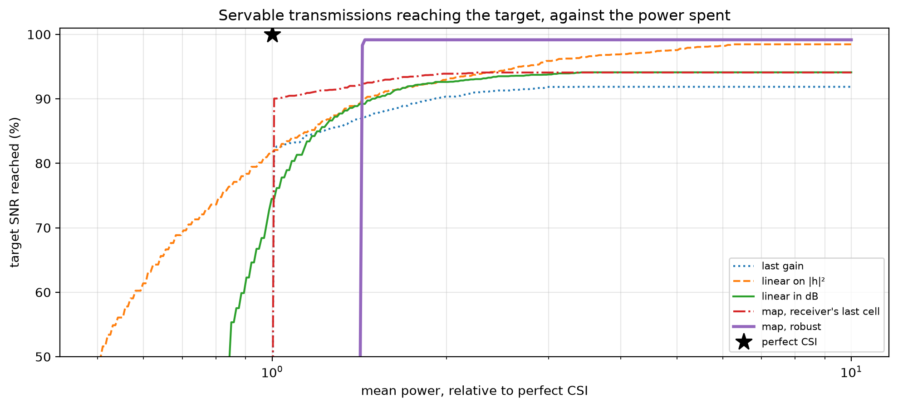

# Power control without channel knowledge


<!-- WARNING: THIS FILE WAS AUTOGENERATED! DO NOT EDIT! -->

Agents on a 9 × 9 grid send each other a 7 × 7 map of codebook tokens at
every step: 49 indices into a codebook of 256, so 392 bits. The link is
the communication model of C3-WM:

- **Modulation:** the bits go out as BPSK. The channel coefficient stays
  the same during a message (block fading), plus AWGN.
- **Detection:** coherent maximum-likelihood, `Re(h* y) ≥ 0`. Bit errors
  are not corrected, so the receiver gets the tokens they produce.
- **Channel inversion:** the transmitter picks the power that reaches a
  target SNR `Γ`, `ρ = Γσ²/ĝ`, for a predicted gain `ĝ`. It sends only
  if `ρ ≤ ρ_max`.

The transmitter does not know the current gain `|h_t|²`, so it predicts
it. The predictors compared here:

<table>
<colgroup>
<col style="width: 33%" />
<col style="width: 33%" />
<col style="width: 33%" />
</colgroup>
<thead>
<tr>
<th>predictor</th>
<th>what the transmitter uses</th>
<th>comm-core</th>
</tr>
</thead>
<tbody>
<tr>
<td>last gain</td>
<td>the link’s gain at the last step</td>
<td><a
href="https://Ahmed-Khaled-Saleh.github.io/comm-core/power_control.html#predictedchannelinversion"><code>PredictedChannelInversion</code></a>
with <code>past[0]</code></td>
</tr>
<tr>
<td>linear on <code>\|h\|²</code></td>
<td>the last 4 gains, least squares on <code>\|h\|²</code> (C3-WM’s eq.
24)</td>
<td><code>fit_gain_predictor(..., domain='linear')</code></td>
</tr>
<tr>
<td>linear in dB</td>
<td>the last 4 gains, least squares in dB</td>
<td><code>fit_gain_predictor(..., domain='db')</code></td>
</tr>
<tr>
<td>map, receiver’s last cell</td>
<td>a ray-traced map, its own cell, the receiver’s last reported
cell</td>
<td><a
href="https://Ahmed-Khaled-Saleh.github.io/comm-core/power_control.html#mapchannelinversion"><code>MapChannelInversion</code></a></td>
</tr>
<tr>
<td>map, robust</td>
<td>the same, plus the receiver’s reported heading: the weakest cell it
can have reached</td>
<td><code>MapChannelInversion(reachable=...)</code></td>
</tr>
<tr>
<td>perfect CSI</td>
<td>the current gain (the ideal)</td>
<td><a
href="https://Ahmed-Khaled-Saleh.github.io/comm-core/power_control.html#channelinversion"><code>ChannelInversion</code></a></td>
</tr>
</tbody>
</table>

**Comparing them fairly.** The transmitter’s job (C3-WM’s eq. 14) is to
reach the target SNR with as little power as possible. A predictor that
underestimates gains reaches the target more often, but spends more
power. So each predictor is run with a margin `m` (`ρ = Γσ²·m/ĝ`),
swept. It is judged by the mean power it needs, relative to perfect
CSI’s, to reach the target on 90%, 95% or 99% of the transmissions that
perfect CSI can serve within `ρ_max`. Links it misses count as failures,
and power spent on links that cannot be served counts as cost.

(Counting lost tokens within a fixed power budget would judge something
else: under a total budget, abandoning weak links and favouring strong
ones loses fewer tokens than reaching the target on every link. That
metric mixes the quality of the prediction with the choice of policy.)

``` python
import math

import matplotlib.pyplot as plt
import numpy as np

from comm_core import *
```

## The channel map

The channel between every pair of grid cells, as a ray tracer gives it.
Here it’s a room with a line-of-sight path and a reflection off each of
the 4 walls, at 2.4 GHz. With Sionna RT, use
`paths.cfr(..., normalize=False)` and
[`RayTracedFading.from_files`](https://Ahmed-Khaled-Saleh.github.io/comm-core/propagation.html#raytracedfading.from_files).

``` python
C, F = 299_792_458.0, 2.4e9
SIZE, HEIGHT = 9, 0.5
cells = [(x, y) for x in range(SIZE) for y in range(SIZE)]
WALLS = [(0, -0.5, -0.6), (0, SIZE - 0.5, -0.6), (1, -0.5, -0.5), (1, SIZE - 0.5, -0.5)]   # (axis, coordinate, reflection)

def channel(tx, rx):
    "Line of sight + one reflection off each wall (image method)."
    tx, rx = np.array([*tx, HEIGHT]), np.array([*rx, HEIGHT])
    h = 0j
    for source, gain in [(tx, 1.0)] + [(tx * np.where(np.arange(3) == a, -1, 1) + 2 * c * (np.arange(3) == a), g) for a, c, g in WALLS]:
        L = np.linalg.norm(rx - source)
        h += gain * C / F / (4 * np.pi * L) * np.exp(-2j * np.pi * F * L / C)
    return h

H = np.array([[channel(tx, rx) if tx != rx else 0 for tx in cells] for rx in cells])   # H[rx, tx]
fading = RayTracedFading(H, cells)
print(f'{len(cells)} cells; path gain between cells: {10 * np.log10(np.abs(H[H != 0]) ** 2).min():.0f} to '
      f'{10 * np.log10(np.abs(H[H != 0]) ** 2).max():.0f} dB')
```

    81 cells; path gain between cells: -91 to -39 dB

## The agents

As in MultiGrid, each agent has a heading, and at each step it stays,
turns left or right, or moves one cell forward if it can. The
application moves the agents and tells the channel where they are;
comm-core never moves anything.

``` python
AGENTS = ['agent_0', 'agent_1', 'agent_2']
STEPS, HISTORY = 50, 4
DIRS = [(1, 0), (0, 1), (-1, 0), (0, -1)]

def walks(seed):
    "One episode: per step, every agent's cell and heading."
    rng = np.random.default_rng(seed)
    start = rng.choice(SIZE * SIZE, len(AGENTS), replace=False)                # distinct cells
    pos = {a: (int(k) // SIZE, int(k) % SIZE) for a, k in zip(AGENTS, start)}
    head = {a: int(rng.integers(4)) for a in AGENTS}
    out = []
    for _ in range(STEPS):
        out.append((dict(pos), dict(head)))
        for a in AGENTS:
            action = rng.integers(4)                                     # stay, left, right, forward
            if action == 1: head[a] = (head[a] - 1) % 4
            if action == 2: head[a] = (head[a] + 1) % 4
            if action == 3:
                nxt = (pos[a][0] + DIRS[head[a]][0], pos[a][1] + DIRS[head[a]][1])
                if 0 <= nxt[0] < SIZE and 0 <= nxt[1] < SIZE and nxt not in [pos[b] for b in AGENTS if b != a]:
                    pos[a] = nxt
    return out

def reachable(cell, heading):
    "Where an agent that reported `cell` and `heading` can be one step later: there, or one cell ahead."
    return [cell, (cell[0] + DIRS[heading][0], cell[1] + DIRS[heading][1])]
```

## Fitting the history predictors

The training set (C3-WM’s D_channel) holds the gain of every directed
link at every step of recorded episodes.
[`gain_windows`](https://Ahmed-Khaled-Saleh.github.io/comm-core/power_control.html#gain_windows)
turns it into (last 4 gains → next gain) pairs, and
[`fit_gain_predictor`](https://Ahmed-Khaled-Saleh.github.io/comm-core/power_control.html#fit_gain_predictor)
fits the linear predictors. The map predictors need no training.

``` python
gain = lambda tx, rx: fading.gain_between(tx, rx)
LINKS = [(s, r) for s in AGENTS for r in AGENTS if s != r]

def link_gains(episode):
    return {(s, r): [gain(pos[s], pos[r]) for pos, _ in episode] for s, r in LINKS}

training = [g for seed in range(300) for g in link_gains(walks(seed)).values()]
psi_lin = fit_gain_predictor(training, history=HISTORY)                   # C3-WM's eq. 24
psi_db = fit_gain_predictor(training, history=HISTORY, domain='db')
```

## The comparison

On test episodes, each predictor’s estimate is computed for every
directed link at every step, from what the transmitter would know then.
For any margin, the power, whether it is sent, and whether the SNR
reaches the target then follow directly.

``` python
db = lambda g: 10 * np.log10(np.maximum(g, 1e-30))
erfc = np.vectorize(math.erfc)
SNR_TARGET, NOISE_W, MAX_POWER_W = 10 ** 0.7, 10 ** ((-94 - 30) / 10), 2e-5          # Γ = 7 dB, σ² = -94 dBm, ρ_max = 20 µW
estimates = {k: [] for k in ('last gain', 'linear on |h|²', 'linear in dB', "map, receiver's last cell", 'map, robust', 'perfect CSI')}
truth = []
for seed in range(10_000, 10_040):
    episode = walks(seed)
    for s, r in LINKS:
        g = [gain(pos[s], pos[r]) for pos, _ in episode]
        for t in range(HISTORY, STEPS):
            past = np.array(g[t - HISTORY:t][::-1])                       # most recent first
            (pos, _), (pos_before, head_before) = episode[t], episode[t - 1]
            truth.append(g[t])
            estimates['last gain'].append(past[0])
            estimates['linear on |h|²'].append(max(psi_lin(past), 0.0))
            estimates['linear in dB'].append(psi_db(past))
            estimates["map, receiver's last cell"].append(gain(pos[s], pos_before[r]))
            near = [c for c in reachable(pos_before[r], head_before[r]) if c in fading.index]
            estimates['map, robust'].append(min(gain(pos[s], c) for c in ([c for c in near if c != pos[s]] or near)))
            estimates['perfect CSI'].append(g[t])
truth = np.array(truth)
estimates = {k: np.array(v) for k, v in estimates.items()}

servable = SNR_TARGET * NOISE_W / truth <= MAX_POWER_W            # perfect CSI can serve these
perfect_power = np.where(servable, SNR_TARGET * NOISE_W / truth, 0.0).mean()

def outcome(estimate, margin_db):
    "(share of the servable transmissions reaching the target, mean power relative to perfect CSI's) at a margin."
    power = SNR_TARGET * NOISE_W * 10 ** (margin_db / 10) / np.maximum(estimate, 1e-30)
    sent = power <= MAX_POWER_W
    reached = sent & (power * truth / NOISE_W >= SNR_TARGET * (1 - 1e-9))
    return reached[servable].mean(), np.where(sent, power, 0.0).mean() / perfect_power

margins = np.arange(-6, 30.01, 0.1)
curves = {k: np.array([outcome(e, m) for m in margins]) for k, e in estimates.items()}

def power_for(k, share):
    "Least relative power at which predictor k reaches the target on `share` of the servable transmissions."
    ok = curves[k][:, 0] >= share
    return curves[k][ok, 1].min() if ok.any() else np.inf

print(f"{'':26s} {'error (dB): mean':>16s} {'spread':>7s} | power to reach Γ on 90 / 95 / 99% (× perfect CSI)")
for k, e in estimates.items():
    err = db(e) - db(truth)
    err = err[np.isfinite(err)]                                    # same cell: no error to measure
    print(f'{k:26s} {err.mean():+16.1f} {err.std():7.1f} | ' +
          '  '.join(f'{power_for(k, q):5.1f}' if np.isfinite(power_for(k, q)) else '  -  ' for q in (0.9, 0.95, 0.99)))
```

                               error (dB): mean  spread | power to reach Γ on 90 / 95 / 99% (× perfect CSI)
    last gain                              -0.0     4.1 |   1.9    -      -  
    linear on |h|²                         +1.8     4.4 |   1.4    2.7    -  
    linear in dB                           +0.0     3.9 |   1.5    -      -  
    map, receiver's last cell              -0.0     3.0 |   1.0    -      -  
    map, robust                            -2.1     3.7 |   1.4    1.4    1.4
    perfect CSI                            +0.0     0.0 |   1.0    1.0    1.0

``` python
fig, ax = plt.subplots(figsize=(10, 4.6))
style = {'last gain': ':', 'linear on |h|²': '--', 'linear in dB': '-', "map, receiver's last cell": '-.', 'map, robust': '-'}
powers = np.geomspace(0.5, 10, 300)
for k, ls in style.items():
    best = [curves[k][curves[k][:, 1] <= p, 0].max() if (curves[k][:, 1] <= p).any() else np.nan for p in powers]
    ax.plot(powers, 100 * np.array(best), ls, lw=2.4 if k == 'map, robust' else 1.5, label=k)
ax.plot(1, 100, 'k*', ms=14, label='perfect CSI')
ax.set(xscale='log', ylim=(50, 101), xlabel='mean power, relative to perfect CSI', ylabel='target SNR reached (%)',
       title='Servable transmissions reaching the target, against the power spent')
ax.grid(alpha=0.3, which='both'); ax.legend(fontsize=8, loc='lower right')
plt.tight_layout()
```



## The same through a network

The analysis above, checked by running comm-core’s power controls for
real, one operating point each. Each predictor runs with the margin at
which it reaches the target on 90% of the servable transmissions, with
the least power, through a
[`LinkLevelChannel`](https://Ahmed-Khaled-Saleh.github.io/comm-core/link.html#linklevelchannel):
every bit, with the gain histories and position reports kept by the
power controls themselves.

``` python
def margin_at(k, share=0.9):
    "The margin at which predictor k reaches the target on `share` of the servable transmissions with the least power."
    ok = curves[k][:, 0] >= share
    return margins[ok][np.argmin(curves[k][ok, 1])]

margin_for = {k: margin_at(k) for k in style}
margin_for['perfect CSI'] = 0.0
heads = {}

def power_control(name, m):
    if name == 'perfect CSI':
        return ChannelInversion(7.0, max_power=MAX_POWER_W)
    if name.startswith('map'):
        return MapChannelInversion(fading, reachable=reachable if name == 'map, robust' else None, states=lambda: heads,
                                   target_snr_db=7.0, max_power=MAX_POWER_W, margin_db=m, fallback=FixedPower(MAX_POWER_W / 2))
    predictor = {'last gain': lambda past: past[0], 'linear on |h|²': psi_lin, 'linear in dB': psi_db}[name]
    return PredictedChannelInversion(predictor, 1 if name == 'last gain' else HISTORY, 7.0, MAX_POWER_W,
                                     fallback_power=MAX_POWER_W / 2, margin_db=m)

def simulate(name, episodes=range(10_000, 10_040)):
    radio = LinkLevelChannel(codec=IndexCodec(256), modulation=BPSK(), fading=fading,
                             power_control=power_control(name, margin_for[name]), noise_power=NOISE_W)
    net = Network([Node(a) for a in AGENTS], FullMeshTopology(AGENTS), IdealProtocol(), AnalyticalBackend(radio))
    rng = np.random.default_rng(0)
    reached, power = [], []
    for seed in episodes:
        episode = walks(seed)
        net.reset(seed)
        for t, (pos, head) in enumerate(episode):
            radio.set_positions(pos)
            heads.clear(); heads.update(head)
            tokens = {a: rng.integers(0, 256, 49) for a in AGENTS}
            for s, r in LINKS:
                net.send(Message(s, r, payload=tokens[s], type='tokens'))
            for res in net.step():
                if t < HISTORY or math.isinf(res.snr_db):          # as in the analysis: from step 4 on
                    continue
                g = 10 ** (res.metadata['channel_gain_db'] / 10)
                power.append(res.metadata['tx_power'])
                if SNR_TARGET * NOISE_W / g <= MAX_POWER_W:                    # servable
                    reached.append(res.success and res.snr_db >= 7.0 - 1e-9)
    return np.mean(reached), np.mean(power) / perfect_power

print(f"{'':26s} {'margin':>8s} {'simulated: reached':>19s} {'power':>6s} | {'analysis: reached':>18s} {'power':>6s}")
for name in list(style) + ['perfect CSI']:
    sim_reached, sim_power = simulate(name)
    ana_reached, ana_power = outcome(estimates[name], margin_for[name])
    print(f'{name:26s} {margin_for[name]:+6.1f}dB {100 * sim_reached:18.1f}% {sim_power:5.2f}x | {100 * ana_reached:17.1f}% {ana_power:5.2f}x')
```

                                 margin  simulated: reached  power |  analysis: reached  power
    last gain                    +3.9dB               90.1%  1.91x |              90.1%  1.91x
    linear on |h|²               +5.4dB               90.0%  1.42x |              90.0%  1.42x
    linear in dB                 +3.1dB               90.0%  1.48x |              90.0%  1.48x
    map, receiver's last cell    -0.0dB               90.1%  1.00x |              90.0%  1.00x
    map, robust                  +0.5dB               98.3%  1.43x |              98.3%  1.43x
    perfect CSI                  +0.0dB              100.0%  1.00x |             100.0%  1.00x

- **History alone can’t make the target reliable.** Last step’s gain, a
  linear fit on `|h|²` (C3-WM’s) or in dB: each reaches the target 90%
  of the time with a margin, but not 95% or 99% within the power budget.
  Their errors have too wide a spread (several dB) for any margin to
  cover. Agents move a whole cell, many wavelengths, between steps, so a
  link’s past says little about its next gain.
- **Fitted on `|h|²`,** the predictor is biased (it overestimates weak
  links) and needs a large margin. In dB, it is unbiased and needs less.
- **The map gives the transmitter what the history lacks.** The
  receiver’s last reported cell alone predicts with less spread. With
  its reported heading as well, the robust lookup takes the weakest cell
  the receiver can have reached. It never overestimates, so it reaches
  the target on nearly every servable transmission, at a fixed extra
  power over perfect CSI.
- **The cost** is a few bits of position and heading in each message,
  and a ray-traced map of the area, which C3-WM computes anyway.
- **Through a network**
  ([`MapChannelInversion`](https://Ahmed-Khaled-Saleh.github.io/comm-core/power_control.html#mapchannelinversion),
  [`PredictedChannelInversion`](https://Ahmed-Khaled-Saleh.github.io/comm-core/power_control.html#predictedchannelinversion)),
  the simulation agrees with the analysis. Small differences come from
  the first steps of each episode, where the power controls fall back to
  a fixed power.

``` python
assert np.isfinite(power_for('map, robust', 0.99))
assert all(power_for(k, 0.99) == np.inf for k in ('last gain', 'linear on |h|²', 'linear in dB'))
assert power_for('map, robust', 0.95) < min(power_for(k, 0.95) for k in ('last gain', 'linear on |h|²', 'linear in dB'))
```
