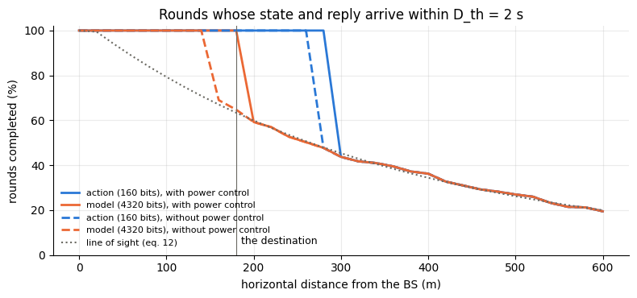
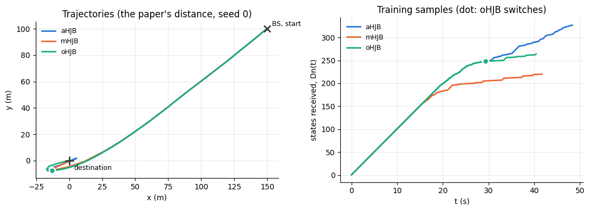
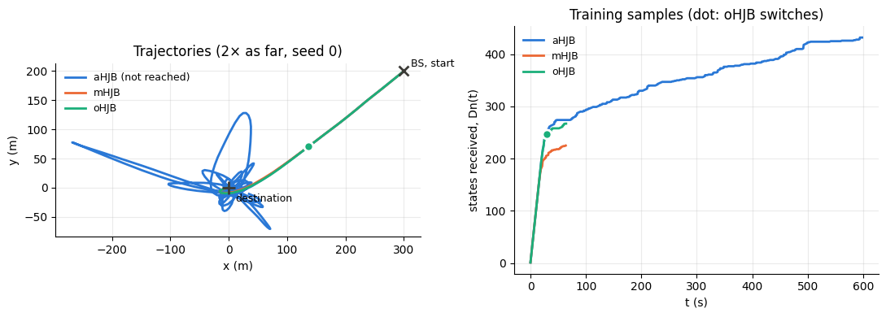

# Remote UAV control, built from blocks


<!-- WARNING: THIS FILE WAS AUTOGENERATED! DO NOT EDIT! -->

In oHJB (Shiri, Park and Bennis, *Remote UAV Online Path Planning via
Neural Network Based Opportunistic Control*), a base station (BS) steers
a UAV to a destination. In each control round `k`, the UAV sends its
state, the BS updates its controller with it and sends back either an
**action** (aHJB) or the **controller itself** (mHJB), which the UAV
then runs on its own. oHJB sends actions first and switches to the
controller once it has seen enough states and the link has become slow.

The communication model (Section III-A) is a chain of steps, and each
one is a comm-core block (see `block`). Built as a
[`PipelineBackend`](https://Ahmed-Khaled-Saleh.github.io/comm-core/backend.html#pipelinebackend),
each step can be replaced on its own:

<table>
<colgroup>
<col style="width: 33%" />
<col style="width: 33%" />
<col style="width: 33%" />
</colgroup>
<thead>
<tr>
<th>oHJB</th>
<th></th>
<th>block</th>
</tr>
</thead>
<tbody>
<tr>
<td>the path loss: 3GPP’s aerial model, line of sight drawn with its
probability, constant during a round and independent across rounds</td>
<td>eqs. 11–12</td>
<td><code>UAVPathLoss</code> (a <a
href="https://Ahmed-Khaled-Saleh.github.io/comm-core/propagation.html#fading"><code>Fading</code></a>)</td>
</tr>
<tr>
<td>the power: 20 dBm at the UAV; 23 dBm at the BS, 26 dBm when 23 would
miss the deadline</td>
<td>eq. 13</td>
<td><code>DeadlinePower</code> (a <a
href="https://Ahmed-Khaled-Saleh.github.io/comm-core/power_control.html#powercontrol"><code>PowerControl</code></a>),
or <a
href="https://Ahmed-Khaled-Saleh.github.io/comm-core/power_control.html#fixedpower"><code>FixedPower</code></a></td>
</tr>
<tr>
<td>the SNR, <code>P · 10^(−L/10) / (N W)</code></td>
<td>eq. 10</td>
<td><a
href="https://Ahmed-Khaled-Saleh.github.io/comm-core/interference.html#sinr"><code>SINR</code></a></td>
</tr>
<tr>
<td>the delay, <code>b / (W log₂(1 + SNR))</code></td>
<td>eq. 10</td>
<td><code>Capacity</code> → <a
href="https://Ahmed-Khaled-Saleh.github.io/comm-core/radio.html#airtime"><code>Airtime</code></a></td>
</tr>
<tr>
<td>the deadline: the round’s state and reply arrive within
<code>D_th</code> of the state’s measurement, or not at all</td>
<td>Sec. III-A</td>
<td><code>Deadline</code></td>
</tr>
<tr>
<td>the payloads: a state is <code>4b</code> bits, an action
<code>2b</code>, the controller <code>Mb</code></td>
<td>Sec. III-B</td>
<td>the messages’ <code>size_bits</code></td>
</tr>
<tr>
<td>the rounds of Algorithms 1–3</td>
<td>Sec. III</td>
<td>the application: a loop around a <a
href="https://Ahmed-Khaled-Saleh.github.io/comm-core/network.html#network"><code>Network</code></a></td>
</tr>
</tbody>
</table>

The paper’s names follow the BS: the *downlink* (DL) is the UAV sending
its state to the BS (the BS downloads it), and the *uplink* (UL) is the
BS sending back an action or the controller (uploading it).

**What is not the paper’s: the controller.** The paper’s HJB NN (eqs.
7–9) is a 54-weight polynomial model trained at each received state. Its
features are sixth powers of positions in metres, and the paper doesn’t
say how they are scaled, so it can’t be rebuilt as written. It is
replaced by the exact solution of the HJB equation for the quadratic
part of the cost (eq. 1 without its first term), whose value function is
quadratic: the LQR. It is reached one update per received state, which
plays the same role as the paper’s training:

- the controller starts untrained and improves with every state the BS
  receives;
- it is still `M = 54` weights of `b` bits on the air, as in the paper.

Three other choices aren’t the paper’s: \* **Acceleration limit.**
Accelerations are limited to 1 m/s², which gives at most 10 m/s against
the drag. The paper’s Fig. 2 stays under 8 m/s. \* **Mission end.** The
mission ends when the UAV is within 2 m of the destination at under 0.5
m/s. The paper doesn’t give `r_th` or `v_th`. \* **Distance.** The
distance `d` in eqs. 11–12 is the 3-D distance. With `d = ‖r − r_s‖`, as
written, it would be 0 at the start, and eq. 12’s `√(d² − h²)` shows `d`
includes the altitude.

``` python
import math
from collections import deque

import matplotlib.pyplot as plt
import numpy as np
from scipy.linalg import solve_continuous_are

from comm_core import *
```

## Settings

As in the paper’s Section IV. Powers are in watts, and the noise power
is the noise density over the bandwidth.

``` python
dBm = lambda x: 10 ** ((x - 30) / 10)
BS = np.array([150.0, 100.0])                 # the BS, and the UAV's start (r_s); the destination is the origin
ALTITUDE, FC_GHZ, W = 30.0, 2.0, 2e6          # h (m), carrier (GHz), bandwidth (Hz)
NOISE_W = dBm(-118) * W                       # N_i W
P_DL, P_UL, P_UL_MAX = dBm(20), dBm(23), dBm(26)
b, M_WEIGHTS = 80, 54                         # 10 bytes per number; the controller's weights
B_STATE, B_ACTION, B_MODEL = 4 * b, 2 * b, M_WEIGHTS * b
D_TH, ALPHA, N_AVG, DN_TH = 2.0, 0.2, 5, 50   # deadline (s), oHJB's switching rule
C0, C1, C2, C3 = 0.1, 0.015, 0.015, 0.005
V_O, V_NOISE, DT = np.array([1.0, -1.0]), 0.1, 0.1   # mean wind (m/s), its perturbation, the time step (s)
A_MAX, R_TH, V_TH = 1.0, 2.0, 0.5             # not in the paper (see above)
```

## The blocks

**`UAVPathLoss`** is a
[`Fading`](https://Ahmed-Khaled-Saleh.github.io/comm-core/propagation.html#fading):
it gives each transmission its coefficient `h = 10^(−L/20)`, with `L`
from eq. 11. Line of sight is drawn with eq. 12’s probability once per
round, so that the round’s state and reply see the same `L` (the paper’s
fully correlated downlink and uplink). The round is the message’s
`metadata['control']`, and the UAV’s position comes from
`set_positions`, as for any fading that depends on where the nodes are.
Its draws use the block’s `rng`, which the network reseeds with every
episode.

``` python
class UAVPathLoss(Fading):
    "3GPP TR 36.777's path loss between a ground BS and a UAV (eqs. 11–12): line of sight drawn once per round."

    def __init__(self, bs, altitude, fc_ghz):
        self.bs, self.altitude, self.fc_ghz = np.asarray(bs, float), altitude, fc_ghz
        self.positions, self._rounds = {}, {}

    def reset(self, seed=None):
        super().reset(seed)
        self._rounds = {}                                         # round -> L (dB)

    def set_positions(self, positions):
        self.positions.update(positions)

    def p_los(self, horizontal):
        "Eq. 12, with the horizontal distance √(d² − h²)."
        lh = math.log10(self.altitude)
        d_o, p_o = max(294.05 * lh - 432.94, 18.0), 233.98 * lh - 0.95
        if horizontal <= d_o:
            return 1.0
        return d_o / horizontal + math.exp(-horizontal / p_o) * (1 - d_o / horizontal)

    def path_loss_db(self, d, los):
        "Eq. 11 at the 3-D distance d."
        lh, f = math.log10(self.altitude), 20 * math.log10(self.fc_ghz)
        l_los = 30.9 + (22.25 - 0.5 * lh) * math.log10(d) + f
        return l_los if los else max(l_los, 32.4 + (43.2 - 7.6 * lh) * math.log10(d) + f)

    def coefficient(self, transmission, link):
        k = transmission.message.metadata['control']
        if k not in self._rounds:
            horizontal = float(np.linalg.norm(np.asarray(self.positions['uav'], float) - self.bs))
            los = self.rng.random() < self.p_los(horizontal)
            self._rounds[k] = self.path_loss_db(math.hypot(horizontal, self.altitude), los)
        return 10 ** (-self._rounds[k] / 20)
```

**`DeadlinePower`** is eq. 13. A power control is given each
transmission’s `|h|²`, link and message (see
[`PowerControl`](https://Ahmed-Khaled-Saleh.github.io/comm-core/power_control.html#powercontrol)).
It sends at the link’s power, unless the delay at that power would
exceed the time left (`metadata['deadline']`, which is `D_th − D_DL` for
the BS’s reply); then it sends at `max_power`. Only the BS does this.

**`Capacity`** gives the symbols a message takes at the Shannon rate:
`b / log₂(1 + SNR)`.
[`Airtime`](https://Ahmed-Khaled-Saleh.github.io/comm-core/radio.html#airtime),
the library’s block, turns symbols into time on the air (symbols /
bandwidth) and energy (power × time). Together they are eq. 10.

**`Deadline`** says what arrives: a message whose delay is within its
time left. A late one is cut off at its deadline, so its energy is only
that of the time it was on the air.

``` python
class DeadlinePower(PowerControl):
    "Eq. 13: the link's power, or `max_power` if the delay at the link's power would miss the deadline (the BS only)."

    def __init__(self, max_power, senders=('bs',)):
        self.max_power, self.senders = max_power, senders

    def allocate(self, gain, noise_power, link=None, message=None):
        p = link.tx_power_w
        if link.sender in self.senders:
            expected = message.size_bits / (link.bandwidth_hz * math.log2(1 + p * gain / noise_power))
            if expected > message.metadata['deadline']:
                p = self.max_power
        return p, True


class Capacity(Block):
    "Symbols to send each message at the Shannon rate: size_bits / log2(1 + SNR)."
    outputs = ('num_symbols',)

    def call(self, size_bits, sinr):
        with np.errstate(divide='ignore'):
            symbols = np.ceil(np.asarray(size_bits, float) / np.log2(1 + np.asarray(sinr).mean(1)))
        return np.minimum(symbols, 1e18)                          # no rate at all: as good as never


class Deadline(Block):
    "A message arrives if its delay is within the time it has left (`metadata['deadline']`); a late one is cut off then."
    outputs = ('success', 'energy')

    def call(self, transmission, latency, energy):
        left = np.array([t.message.metadata['deadline'] for t in transmission])
        latency = np.asarray(latency, float)
        with np.errstate(invalid='ignore'):
            sent = np.where(latency > left, np.maximum(left, 0) / latency, 1.0)   # the share of it on the air
        return latency <= left, np.asarray(energy) * sent
```

## The pipeline

The blocks in order, with the library’s
[`SINR`](https://Ahmed-Khaled-Saleh.github.io/comm-core/interference.html#sinr)
and
[`Airtime`](https://Ahmed-Khaled-Saleh.github.io/comm-core/radio.html#airtime)
between them. The topology has one link per direction, each with its
bandwidth and power:

``` python
def radio(power_control, bs=BS):
    "The communication model of oHJB, as blocks."
    return [UAVPathLoss(bs, ALTITUDE, FC_GHZ), power_control, SINR(), Capacity(), Airtime(), Deadline()]

UAV_BS = Link('uav', 'bs', bandwidth_hz=W, tx_power_w=P_DL)          # the paper's downlink: the state
BS_UAV = Link('bs', 'uav', bandwidth_hz=W, tx_power_w=P_UL)          # the paper's uplink: an action or the model
TOPOLOGY = GraphTopology([UAV_BS, BS_UAV])

backend = PipelineBackend(radio(DeadlinePower(P_UL_MAX)), noise_power=NOISE_W)
print(' → '.join(type(block).__name__ for block in backend.pipeline))
print('inputs:', backend.pipeline.required)
print('outputs:', backend.pipeline.outputs)
```

    UAVPathLoss → DeadlinePower → SINR → Capacity → Airtime → Deadline
    inputs: ('transmission', 'link', 'sender', 'receiver', 'size_bits', 'group', 'noise_power')
    outputs: ('h', 'power', 'active', 'sinr', 'num_symbols', 'latency', 'energy', 'success')

[`PipelineBackend`](https://Ahmed-Khaled-Saleh.github.io/comm-core/backend.html#pipelinebackend)
checks the wiring when it is built. Every input a block needs is either
one of the step’s inputs (`transmission`, `link`, `size_bits`, …), the
constant `noise_power`, or given by a block before it.

A check against eq. 10 by hand: a state sent from 100 m in line of
sight, through the pipeline.

``` python
def message(sender, receiver, size_bits, k, deadline=D_TH):
    return Message(sender, receiver, None, size_bits=size_bits, metadata={'control': k, 'deadline': deadline})

def rows(messages):
    return [(Transmission(m, m.sender, m.receiver, 0.0), TOPOLOGY.get_link(m.sender, m.receiver)) for m in messages]

pl = UAVPathLoss(BS, ALTITUDE, FC_GHZ)
assert pl.p_los(10.0) == 1.0 and 0 < pl.p_los(300.0) < 1
backend.set_positions({'uav': BS + [100.0, 0.0]})                     # p_LOS = 0.79: draw until a round is in LOS
backend.reset(seed=0)
k = next(k for k in range(100) if (state := backend.pipeline(**step_inputs(rows([message('uav', 'bs', B_STATE, k)])),
                                                             noise_power=NOISE_W))['h'][0, 0] ** 2 > 10 ** (-8.5))
L = pl.path_loss_db(math.hypot(100.0, ALTITUDE), los=True)
expected = B_STATE / (W * math.log2(1 + P_DL * 10 ** (-L / 10) / NOISE_W))
assert abs(state['latency'][0] - expected) < 1 / W and state['success'][0]
print(f'L = {L:.1f} dB, SNR = {10 * math.log10(state["sinr"][0, 0]):.1f} dB, the state takes {1e3 * expected:.2f} ms')
```

    L = 80.3 dB, SNR = -5.4 dB, the state takes 0.43 ms

## The link along the way

How often a round completes (the state and the reply both arrive within
`D_th`) depends on how far the UAV is from the BS and on what the BS
sends back. With the pipeline alone, without a network or a UAV: 400
rounds at each distance, each state sent in one call of the blocks, then
the replies with the time each has left. The replies use the same
rounds, and so the same draws of line of sight.

``` python
def completes(power_control, distance, n=400, seed=0):
    "Share of n rounds at `distance` (m, horizontal) whose state and reply both arrive in time, per kind of reply."
    backend = PipelineBackend(radio(power_control), noise_power=NOISE_W)
    backend.reset(seed=seed)
    backend.set_positions({'uav': BS + [distance, 0.0]})
    states = backend.transmit_all(rows([message('uav', 'bs', B_STATE, k) for k in range(n)]))
    out = {}
    for kind, size in (('action', B_ACTION), ('model', B_MODEL)):
        replies = [message('bs', 'uav', size, k, D_TH - r.latency) for k, r in enumerate(states) if r.success]
        out[kind] = sum(r.success for r in backend.transmit_all(rows(replies))) / n
    return out

DISTANCES = np.arange(0, 601, 20)
curves = {(pc, kind): [] for pc in ('PC', 'no PC') for kind in ('action', 'model')}
for pc, make in (('PC', lambda: DeadlinePower(P_UL_MAX)), ('no PC', FixedPower)):
    for d in DISTANCES:
        for kind, share in completes(make(), d).items():
            curves[pc, kind].append(share)
p_los = [UAVPathLoss(BS, ALTITUDE, FC_GHZ).p_los(d) for d in DISTANCES]
```

``` python
colors = {'action': '#2a78d6', 'model': '#eb6834'}                  # categorical slots 1 and 2
fig, ax = plt.subplots(figsize=(8, 3.8))
for (pc, kind), y in curves.items():
    ax.plot(DISTANCES, 100 * np.array(y), '-' if pc == 'PC' else '--', color=colors[kind], lw=2,
            label=f'{kind} ({b * M_WEIGHTS if kind == "model" else 2 * b} bits), {"with" if pc == "PC" else "without"} power control')
ax.plot(DISTANCES, 100 * np.array(p_los), ':', color='#6b6a63', lw=1.5, label='line of sight (eq. 12)')
ax.axvline(np.linalg.norm(BS), color='#6b6a63', lw=0.8)
ax.annotate('the destination', (np.linalg.norm(BS), 5), xytext=(4, 0), textcoords='offset points', fontsize=9)
ax.set(xlabel='horizontal distance from the BS (m)', ylabel='rounds completed (%)', ylim=(0, 102),
       title='Rounds whose state and reply arrive within D_th = 2 s')
ax.grid(alpha=0.25)
for side in ('top', 'right'):
    ax.spines[side].set_visible(False)
ax.legend(frameon=False, fontsize=8, loc='lower left')
plt.tight_layout()
plt.show()
```



- **An action gets through wherever the state does.** At 160 bits it
  needs little rate, and a round fails only once the state itself takes
  most of the 2 s. In non-line of sight, that is beyond about 260 m
  without power control and 280 m with it.
- **The controller needs much more.** At 4320 bits (27× an action), it
  misses the deadline in non-line of sight from about 140 m. Eq. 13’s 3
  dB boost moves that to about 190 m, just past the destination (180 m).
- Beyond those distances, a round completes only in line of sight, which
  eq. 12 makes rarer with distance.

## The controller

The UAV’s state is `s = [r, v]`, and it moves as eq. 3:
`ds = (As + B(a + c₀v_o)) dt + G dW`. The quadratic part of eq. 1’s cost
is `c₁‖r‖² + c₂‖v‖² + c₃‖a‖²`, whose HJB solution is `ψ = sᵀPs`, with
`P` solving the Riccati equation and `a = −Ks − c₀v_o` (`K = Bᵀ P / c₃`,
as eq. 6). The BS starts from `P = 0` and takes one step of the Riccati
equation per state it receives, which is value iteration with a horizon
0.1 s longer per update. The paper’s model starts from `w = 0`
(`a = 0`); this one starts by only cancelling the mean wind.

After 50 updates (the paper’s `Dn_th`), it is the LQR to within 1%:

``` python
A = np.block([[np.zeros((2, 2)), np.eye(2)], [np.zeros((2, 2)), -C0 * np.eye(2)]])
B = np.vstack([np.zeros((2, 2)), np.eye(2)])
Q, R = np.diag([C1, C1, C2, C2]), C3 * np.eye(2)

def train(P, step=0.1):
    "One update of the BS's controller: a step of the Riccati equation (value iteration)."
    return P + step * (A.T @ P + P @ A - P @ B @ np.linalg.solve(R, B.T @ P) + Q)

def model(P):
    "The weights the BS uploads: the feedback gain K."
    return np.linalg.solve(R, B.T @ P)

def act(K, s):
    "The action of the controller K at state s (eq. 6), at most A_MAX."
    a = -K @ s - C0 * V_O
    return a * min(1.0, A_MAX / np.linalg.norm(a))

P = np.zeros((4, 4))
error = []
for n in range(100):
    P = train(P)
    error.append(np.abs(model(P) - model(solve_continuous_are(A, B, Q, R))).max() / model(solve_continuous_are(A, B, Q, R)).max())
assert error[49] < 0.01 and error[9] > 0.3
print(f'after 10 updates: {100 * error[9]:.0f}% off; after 50: {100 * error[49]:.2f}%')
```

    after 10 updates: 35% off; after 50: 0.00%

## The rounds

Algorithms 1–3, around a
[`Network`](https://Ahmed-Khaled-Saleh.github.io/comm-core/network.html#network)
with this pipeline as its backend. In round `k`:

1.  At `t_o,k` the UAV sends its state (`4b` bits). If it arrives within
    `D_th`, after `D_DL`:
2.  the BS updates its controller and, at `t_o,k + D_DL`, sends an
    action or the controller, with `D_th − D_DL` left. The action is
    computed from the state the BS received, which is `D_DL` old.
3.  The UAV acts with the most recent action it received, held until the
    next one, or with the most recent controller it received, applied to
    its current state every `Δt`.
4.  The next round starts when the reply arrives, or at `D_th` if
    something was lost, on the grid of `Δt`.

oHJB switches to the controller when it has received `Dn_th` states and
the mean delay of the last `N` received states exceeds `αD_th`, and
stays with it, as the paper’s text and Fig. 2 describe. Algorithm 3’s
line 5 says “`Dn ≥ Dn_th` **or** `D̄ ≤ αD_th`” for actions, which
contradicts the text. `Dn` and `Up` count the received states and the
received replies.

``` python
RULES = {
    'aHJB': lambda dn, delay: 'action',
    'mHJB': lambda dn, delay: 'model',
    'oHJB': lambda dn, delay: 'model' if dn >= DN_TH and delay > ALPHA * D_TH else 'action',
}

def fly(rule, power_control, seed, bs=BS, t_max=600.0):
    "One mission from the BS to the origin: travel time T (inf: not reached), motion energy E(T), and the rounds."
    backend = PipelineBackend(radio(power_control, bs), noise_power=NOISE_W)
    net = Network([Node('uav'), Node('bs')], TOPOLOGY, IdealProtocol(), backend)
    net.reset(seed=seed)
    wind = np.random.default_rng(seed)
    s, t, k, P = np.r_[bs, 0.0, 0.0], 0.0, 0, np.zeros((4, 4))
    held, controller, arriving = np.zeros(2), None, deque()       # what the UAV acts with; replies on their way
    dn, up, delays, switched, energy, log = 0, 0, deque(maxlen=N_AVG), None, 0.0, []
    while t < t_max and not (np.linalg.norm(s[:2]) <= R_TH and np.linalg.norm(s[2:]) <= V_TH):
        backend.set_positions({'uav': s[:2].copy()})
        net.send(Message('uav', 'bs', s.copy(), size_bits=B_STATE, metadata={'control': k, 'deadline': D_TH}))
        [state] = net.step_to(t)
        end = t + D_TH
        if state.success:                                         # the BS has the state, D_DL after t_o,k
            dn += 1
            delays.append(state.latency)
            P = train(P)
            kind = 'model' if switched is not None else RULES[rule](dn, np.mean(delays))
            if kind == 'model' and switched is None:
                switched = t
            content = act(model(P), state.payload) if kind == 'action' else model(P)
            net.send(Message('bs', 'uav', content, size_bits=B_ACTION if kind == 'action' else B_MODEL,
                             metadata={'control': k, 'deadline': D_TH - state.latency}), at=t + state.latency)
            [reply] = net.step_to(t + state.latency)
            if reply.success:
                up += 1
                end = t + state.latency + reply.latency
                arriving.append((end, kind, reply.payload))
        steps = max(1, math.ceil((end - t) / DT - 1e-9))
        for i in range(steps):                                    # the UAV flies until the next round
            while arriving and arriving[0][0] <= t + i * DT + 1e-9:
                _, kind, content = arriving.popleft()
                held, controller = (content, None) if kind == 'action' else (held, content)
            a = act(controller, s) if controller is not None else held
            energy += (C2 * s[2:] @ s[2:] + C3 * a @ a) * DT
            s = s + np.r_[s[2:], -C0 * s[2:] + a + C0 * V_O] * DT + np.r_[0, 0, V_NOISE * math.sqrt(DT) * wind.standard_normal(2)]
        log.append((t, s[0], s[1], dn, up))
        t, k = t + steps * DT, k + 1
    reached = np.linalg.norm(s[:2]) <= R_TH and np.linalg.norm(s[2:]) <= V_TH
    return dict(T=t if reached else math.inf, E=energy, dn=dn, up=up, switched=switched if rule == 'oHJB' else None,
                comm=net.metrics.summary().total_energy, log=np.array(log))
```

## At the paper’s distance

Each method with and without the power boost, over 8 missions (seeds:
the wind and the line of sight):

``` python
SEEDS = range(8)
POWER = {'PC': lambda: DeadlinePower(P_UL_MAX), 'no PC': FixedPower}

def table(bs=BS, power=POWER):
    runs = {(pc, rule): [fly(rule, make(), seed, bs) for seed in SEEDS] for pc, make in power.items() for rule in RULES}
    print(f'{"":14s}{"reached":>9s}{"T (s)":>8s}{"E(T)":>8s}{"Dn":>6s}{"Up":>6s}{"radio (J)":>11s}{"switch (s)":>12s}')
    for (pc, rule), rs in runs.items():
        T = np.array([r['T'] for r in rs])
        switch = [r['switched'] for r in rs if r['switched'] is not None]
        print(f'{rule + ", " + pc:14s}{np.mean(np.isfinite(T)):9.0%}{np.median(T):8.1f}{np.median([r["E"] for r in rs]):8.1f}'
              f'{np.median([r["dn"] for r in rs]):6.0f}{np.median([r["up"] for r in rs]):6.0f}'
              f'{np.median([r["comm"] for r in rs]):11.2f}{np.median(switch) if switch else math.nan:12.1f}')
    return runs

runs = table()
```

                    reached   T (s)    E(T)    Dn    Up  radio (J)  switch (s)
    aHJB, PC           100%    48.2    22.5   317   317       2.28         nan
    mHJB, PC           100%    41.6    21.7   216   212       6.20         nan
    oHJB, PC           100%    46.3    22.5   288   287       3.77        35.3
    aHJB, no PC        100%    48.2    22.5   317   317       2.28         nan
    mHJB, no PC        100%    41.2    21.7   214   207       3.90         nan
    oHJB, no PC        100%    46.9    22.7   290   285       2.89        35.3

``` python
COLORS = {'aHJB': '#2a78d6', 'mHJB': '#eb6834', 'oHJB': '#1baf7a'}   # categorical slots 1-3

def show(runs, bs, title, seed=0):
    "The trajectories of one mission per method (with power control), and the states each received."
    fig, (ax1, ax2) = plt.subplots(1, 2, figsize=(11, 4))
    for rule, color in COLORS.items():
        r = runs['PC', rule][seed]
        t, x, y, dn, up = r['log'].T
        ax1.plot(x, y, color=color, lw=2, label=f'{rule}' + ('' if math.isfinite(r['T']) else ' (not reached)'))
        ax2.plot(t, dn, color=color, lw=2, label=rule)
        if r['switched'] is not None:
            i = np.searchsorted(t, r['switched'])
            for ax, point in ((ax1, (x[i], y[i])), (ax2, (t[i], dn[i]))):
                ax.plot(*point, 'o', color=color, ms=8, mec='white', mew=2)
    ax1.plot(*bs, 'x', color='#3b3a36', ms=9, mew=2)
    ax1.annotate('BS, start', bs, xytext=(6, 4), textcoords='offset points', fontsize=9)
    ax1.plot(0, 0, '+', color='#3b3a36', ms=11, mew=2)
    ax1.annotate('destination', (0, 0), xytext=(6, -12), textcoords='offset points', fontsize=9)
    ax1.set(xlabel='x (m)', ylabel='y (m)', title=f'Trajectories ({title}, seed {seed})', aspect='equal')
    ax2.set(xlabel='t (s)', ylabel='states received, Dn(t)', title='Training samples (dot: oHJB switches)')
    for ax in (ax1, ax2):
        ax.grid(alpha=0.25)
        for side in ('top', 'right'):
            ax.spines[side].set_visible(False)
        ax.legend(frameon=False, fontsize=9)
    plt.tight_layout()
    plt.show()

show(runs, BS, "the paper's distance")
```



- **All three methods reach the destination, with or without power
  control.** Within 180 m, the link serves all of them.
- **mHJB is the fastest: 41.6 s, against 48.2 s for aHJB and 46.3 s for
  oHJB.** With the controller on board, the UAV acts on its current
  state every 0.1 s. An action is computed from the state at the start
  of the round and held until the next one arrives, so near the
  destination the UAV corrects late and takes longer to settle.
- **More training samples buy nothing here.** aHJB receives the most
  states (317, against 216 for mHJB). But the stand-in controller is
  fully trained after 50 of them, in the first 5 s, while the UAV is
  close to the BS and every reply takes under 0.1 s. That removes the
  paper’s reason to send actions first. Its HJB NN trains slowly, so
  there the extra samples matter.
- **Power control matters only for mHJB, and little.** It boosts the
  controller’s uploads in non-line of sight beyond 140 m. A lost upload
  leaves the UAV with the previous controller, already trained, so the
  travel time barely changes (41.6 s against 41.2 s), while the radio
  energy goes from 3.9 J to 6.2 J. Actions never need the boost within
  180 m.
- **oHJB switches at about 35 s (the median),** once its last five
  states took 0.4 s on average. That happens in non-line of sight, far
  out.

## Farther from the base station

The same mission with the BS (and the start) 2× and 3× as far from the
destination, 361 m and 541 m. Power control is on: beyond about 300 m, a
round in non-line of sight loses the state itself, before the BS could
boost anything (the figure above).

``` python
far = {scale: table(BS * scale, {'PC': POWER['PC']}) for scale in (2, 3)}
```

                    reached   T (s)    E(T)    Dn    Up  radio (J)  switch (s)
    aHJB, PC             0%     inf   268.3   462   458      56.85         nan
    mHJB, PC           100%    63.5    48.2   218   212       7.26         nan
    oHJB, PC           100%    61.8    48.2   276   272       4.79        32.6
                    reached   T (s)    E(T)    Dn    Up  radio (J)  switch (s)
    aHJB, PC             0%     inf   406.0   358   358      57.29         nan
    mHJB, PC           100%    81.4    74.8   220   214       8.97         nan
    oHJB, PC           100%    79.9    74.8   278   274       6.59        32.7

``` python
show(far[2], 2 * BS, '2× as far')
```



- **aHJB never arrives.** Beyond 300 m, a round in non-line of sight
  loses the state, and the UAV holds its last action for the whole 2 s,
  often for several rounds in a row. A saturated action held that long
  overshoots, which takes the UAV farther from the BS, where more rounds
  are lost. In the figure, it circles the destination, as far as 270 m
  from it, until the 600 s limit. This is the failure the paper reports
  for aHJB.
- **mHJB and oHJB arrive every time, within 2.5% of each other’s travel
  time:** 63.5 s and 61.8 s at 2×, 81.4 s and 79.9 s at 3×. A UAV that
  runs its controller loses nothing when a round is lost.
- **oHJB uses about a third less radio energy than mHJB:** 4.8 J against
  7.3 J at 2×, and 6.6 J against 9.0 J at 3×. Near the BS, actions do as
  well as the controller at 1/27 of the size. oHJB switches at about 33
  s, once the rounds slow down.

**Against the paper.** The communication model gives the paper’s
trade-off: actions are cheap and work while the link holds, and only a
controller on board survives losing it. oHJB arrives whenever mHJB does.
Its travel time is within 2.5% of mHJB’s far from the BS and 11% longer
at the paper’s distance, and it uses the least radio energy of the
methods that arrive far out. The paper also finds oHJB 13% faster than
both, and mHJB failing without power control. Those results depend on
how slowly its HJB NN trains, which the stand-in controller doesn’t
reproduce. Replacing the controller is a change to the application only.
The blocks and the network stay as they are.
